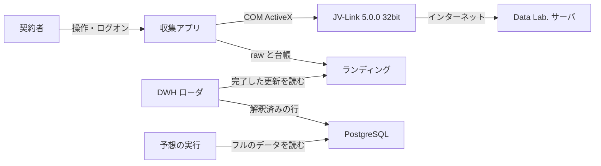
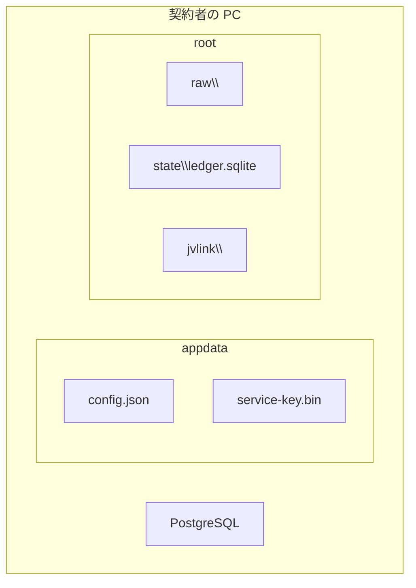

# 競馬データ倉庫 アーキテクチャ

- 状態: ドラフト
- 日付: 2026-11-03
- 要求: [requirements.md](requirements.md)
- 収集アプリ: [jv-data-collector/architecture.md](jv-data-collector/architecture.md)
- ローダ: [dwh-loader/architecture.md](dwh-loader/architecture.md)
- ローダの設計: [dwh-loader/design.md](dwh-loader/design.md)
- PostgreSQL: [dwh-loader/postgresql.md](dwh-loader/postgresql.md)
- データベース定義書: [dwh-loader/schema.md](dwh-loader/schema.md)
- 位置づけ: 収集アプリとローダの境界、および予想実行との契約。取得手順と画面は収集アプリの設計、テーブル・キー・ビューは [dwh-loader/schema.md](dwh-loader/schema.md)、予想プロセスの置き方は未決。レコードのバイト定義は公式仕様書を正とし、ここでは再定義しない。

## 1. 結論

一式は、同じ契約者の PC で動く。収集アプリと DWH ローダは別プロセスである。予想の実行は、そのどちらにも入らない。予想を起動するプロセスの置き方は未決である。

収集アプリは、ログオン セッションの C# / Windows Forms トレイ アプリ 1 プロセスである。ターゲットフレームワークは `net10.0-windows`、プロセスは x86。JV-Link から届いたバイト列を raw に追記し、水位と索引を SQLite に書く。PostgreSQL には接続しない。

DWH ローダは別プロセスである。完了した raw の更新と、それを指す索引だけを読み、解釈した行を PostgreSQL に書く。起動は実行ファイルの実行であり、ログオン時の登録はしない。プロセスが動いているあいだ、ファイルごとには起動しない。JV-Link は呼ばない。予想モデルは起動しない。

公式 SDK の実体は [reference/](reference/) に置く。収集アプリとローダのどちらにも同梱しない。

## 2. システムコンテキスト

境界:

| 持つもの | 主体 |
| --- | --- |
| スケジュール、水位、可逆保存、常駐、通知領域 | 収集アプリ |
| 利用規約の同意、サーバとの通信、`cache` と `data`、設定ダイアログ | JV-Link |
| 推奨キーによる最新行、2023-08-08 前後のフィールド長、速報と確定成績の優先、`0B14` の最新世代、完了した更新の PostgreSQL への自動ロード | DWH ローダ |
| 解釈済みの行 | PostgreSQL |
| 開始契機の速報が載り終えたあとの、フルデータによる馬券予想モデルの起動 | 予想の実行。プロセスの置き方は未決 |

収集アプリのプロセス、スレッド、モジュールは [jv-data-collector/architecture.md](jv-data-collector/architecture.md)。ローダの入出力は [dwh-loader/architecture.md](dwh-loader/architecture.md)。

## 3. ランディング契約

ローダが読む場所は `DataRoot\raw` と `DataRoot\state\ledger.sqlite` だけである。フレームの並び、256 MB での切り替え、台帳の列は [jv-data-collector/design.md](jv-data-collector/design.md) のランディングを正とする。

収集アプリが守る条件:

- 完了前のファイルをローダ向けの索引に出さない
- 完了済みの raw を書き換えない
- 未知のレコード種別 ID を落としたり、取得を止めたりしない
- 接続文字列、スキーマ、テーブルを持たない

ローダが守る条件:

- `complete = 1` の raw だけを読む
- 完了済みファイルが不変であることに依存してよい
- 推奨キーとデータ作成年月日、レイアウトの世代差、速報と `RACE` の優先、`0B14` の最新世代を自分で決める
- 接続のホスト、ポート、データベース名、認証を自分の設定に置く。収集アプリの `config.json` には置かない

## 4. 配置

| パス | 書くプロセス | 内容 |
| --- | --- | --- |
| `%AppData%\KeibaDwh\Collector` | 収集アプリ | 設定、暗号化した利用キー、ログ |
| `DataRoot\jvlink\` | JV-Link | `cache` と `data`。収集アプリはフォルダを用意する |
| `DataRoot\raw\` | 収集アプリ | 追記専用のフレーム。ローダは完了分だけ読む |
| `DataRoot\state\ledger.sqlite` | 収集アプリ | 水位、実行履歴、索引、`0B14` の世代 |
| PostgreSQL | ローダ | 解釈済みの行。同一 PC |

収集アプリのバイナリの置き場所と更新は [jv-data-collector/deployment.md](jv-data-collector/deployment.md)。

PostgreSQL の導入は [dwh-loader/postgresql.md](dwh-loader/postgresql.md)。

## 5. 技術選定

| 項目 | 決定 | 詳細 |
| --- | --- | --- |
| 収集アプリ | C#、Windows Forms、x86、`net10.0-windows` | [jv-data-collector/architecture.md](jv-data-collector/architecture.md) |
| 収集の台帳 | SQLite。WAL。アプリとローダが同時に読める | 同上 |
| 生データ | 追記フレーム。文字コード変換と項目分割をしない | [jv-data-collector/design.md](jv-data-collector/design.md) |
| 倉庫 | PostgreSQL 18 のデータベース `keiba`。JRA-VAN の JV-Data はスキーマ `jv`。別の競馬データはスキーマを足す | [dwh-loader/postgresql.md](dwh-loader/postgresql.md) |
| ローダ | 別プロセスの C#。接続は Npgsql。構造体は SDK の C# 版 | [dwh-loader/architecture.md](dwh-loader/architecture.md) |
| 時刻 | 台帳に残す瞬間は UTC。JV-Link との境界とカレンダーは日本標準時 | 収集アプリの設計 |

ローダのターゲットフレームワーク、プロセス、完了ファイルの読み方は [dwh-loader/design.md](dwh-loader/design.md) で決めた。要求は、プロセスが動いているあいだ、完了した更新がファイルごとの起動なしで PostgreSQL に載ることである。ログオン時の登録はしない。予想を起動するプロセスの置き方は未決である。

## 6. 文書の分担

| 文書 | 決めること |
| --- | --- |
| [requirements.md](requirements.md) | 一式として何をするか |
| [architecture.md](architecture.md) | プロセスの境界とランディング契約 |
| [jv-data-collector/requirements.md](jv-data-collector/requirements.md) | 収集アプリの利用者要求と画面 |
| [jv-data-collector/architecture.md](jv-data-collector/architecture.md) | 収集アプリのプロセス、スレッド、モジュール |
| [jv-data-collector/design.md](jv-data-collector/design.md) | 取得手順、対象データ、保存形式、受入条件 |
| [jv-data-collector/manual.md](jv-data-collector/manual.md) | 収集アプリを入れて、動かし、止める手順 |
| [jv-data-collector/deployment.md](jv-data-collector/deployment.md) | 収集アプリのインストール先、公開、更新、削除 |
| [dwh-loader/requirements.md](dwh-loader/requirements.md) | ローダが満たすこと |
| [dwh-loader/architecture.md](dwh-loader/architecture.md) | ローダの入出力と解釈の責務 |
| [dwh-loader/design.md](dwh-loader/design.md) | 追随の手順、完了ファイルの読み方、展開、受入条件 |
| [dwh-loader/postgresql.md](dwh-loader/postgresql.md) | PostgreSQL 18 の導入 |
| [dwh-loader/schema.md](dwh-loader/schema.md) | データベース定義。テーブル、主キー、有効な版のビュー |
| [reference/](reference/) | 公式 SDK。バイト定義の正本は仕様書 |

## 7. 未決

- バックアップとリストア。PostgreSQL の導入は [dwh-loader/postgresql.md](dwh-loader/postgresql.md)。ローダのプロセスと権限は [dwh-loader/design.md](dwh-loader/design.md)
- 馬券予想モデルを起動するプロセスの置き方。契機と入力は [requirements.md](requirements.md)

テーブル、主キー、有効な版、特別登録馬の区分 1 と区分 2 は [dwh-loader/schema.md](dwh-loader/schema.md)。
