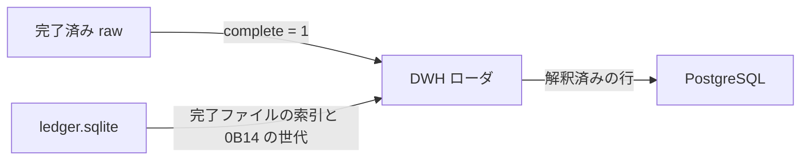

# DWH ローダ アーキテクチャ

- 状態: ドラフト
- 日付: 2026-11-08
- 要求: [requirements.md](requirements.md)
- 設計: [design.md](design.md)
- 全体の要求: [../requirements.md](../requirements.md)
- 全体の構造: [../architecture.md](../architecture.md)
- PostgreSQL: [postgresql.md](postgresql.md)
- データベース定義書: [schema.md](schema.md)
- 入力の形式: [../jv-data-collector/design.md](../jv-data-collector/design.md)
- 位置づけ: ローダのプロセス境界と解釈の責務。モジュール分割、追随、完了ファイルの読み方は [design.md](design.md)。テーブルと有効な版は [schema.md](schema.md)。完了した生データの更新で PostgreSQL に載せることは [requirements.md](requirements.md) で決まっている。レコードのバイト定義は公式仕様書を正とし、ここでは再定義しない。

## 1. 結論

ローダは収集アプリとは別の C# プロセスである。JV-Link を参照しない。読むのは `DataRoot` の完了済み raw と `ledger.sqlite` であり、書くのは、この PC に入っている PostgreSQL 16 である。接続には Npgsql を使う。バイト列の展開には SDK の C# 構造体を使い、収集アプリはその構造体へ展開しない。

プロセスの置き方、ターゲットフレームワーク、完了ファイルの読み方、画面は [design.md](design.md) で決めた。収集アプリの x86 とは別に、ローダは `net10.0-windows` の x64 である。起動は実行ファイルの実行であり、ログオン時の登録はしない。動いているあいだ、完了ファイルを読む。状態と設定の窓はホストが持つ。通知領域には置かない。

## 2. 入出力

| 向き | 相手 | 内容 |
| --- | --- | --- |
| 入力 | `DataRoot\raw` | `JVRead` / `JVGets` のバイト列。完了フラグが立ったファイルだけ |
| 入力 | `DataRoot\state\ledger.sqlite` | 完了ファイルを指す索引、`0B14` の世代。水位は読んでも進めない |
| 出力 | PostgreSQL | 推奨キーで揃えた解釈済みの行 |
| 設定 | ローダ自身 | ホスト、ポート、データベース名、認証 |

SQLite は収集アプリが WAL で開く。ローダは同時に読めることだけを前提にし、収集アプリのテーブルを書き換えない。

## 3. 解釈の責務

ローダが決めること:

- 推奨キーとデータ作成年月日による最新行
- 2023-08-08 を境にしたフィールド長の違い
- `RACE` の確定成績と、`0B12` / `0B15` の速報の優先
- `0B14` の最新世代だけを有効にすること
- 未知のレコード種別を倉庫へ入れるか捨てるか

収集アプリがすでに決めたことには手を入れない。フレームのハッシュ重複、水位、再開カーソル、速報の取得間隔は収集側の責務である。

公式仕様の版と、収集が残す dataspec の範囲は [../jv-data-collector/design.md](../jv-data-collector/design.md) を正とする。SDK のファイルは [../reference/](../reference/) にある。ローダがコンパイルする C# 構造体は、その 64bit 版から `DwhLoader.Structs` へコピーした `JVData_Struct.cs` である。

## 4. 技術選定

| 項目 | 決定 |
| --- | --- |
| 言語 | C# |
| プロセス | 収集アプリの外。COM は呼ばない。状態と設定は Windows Forms。x64、`net10.0-windows` |
| 接続 | Npgsql |
| 倉庫 | この PC に入っている PostgreSQL 16 のデータベース `keiba`。サービスは `postgresql-x64-16`、ポートは `5432`。書くスキーマは `jv`（JRA-VAN Data Lab. の JV-Data）。サーバは [postgresql.md](postgresql.md) |
| 構造体 | SDK の C# 版。収集アプリは使わない |
| 秘密 | 利用キーは持たない。データベース認証はローダの設定に置く。パスワードと接続文字列は画面とログに出さない |

## 5. 未決

- バックアップとリストア。使用するサーバは [postgresql.md](postgresql.md)

テーブル、主キー、有効な版、特別登録馬の区分 1 と区分 2 は [schema.md](schema.md) とする。プロセス、ターゲットフレームワーク、完了ファイルの読み方、ロールの権限は [design.md](design.md) とする。
