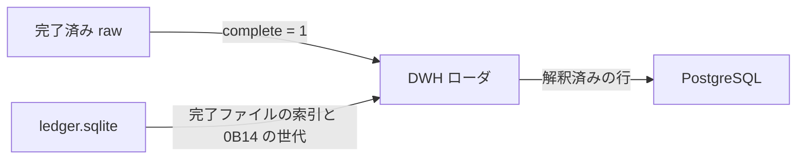

# DWH ローダ アーキテクチャ

- 状態: ドラフト
- 日付: 2026-11-02
- 要求: [requirements.md](requirements.md)
- 全体の要求: [../requirements.md](../requirements.md)
- 全体の構造: [../architecture.md](../architecture.md)
- 倉庫: [warehouse.md](warehouse.md)
- 入力の形式: [../jv-data-collector/design.md](../jv-data-collector/design.md)
- 位置づけ: ローダのプロセス境界と解釈の責務。モジュール分割、自動追随の実装、DDL は未決。完了した生データの更新で PostgreSQL に載せることは [requirements.md](requirements.md) で決まっている。レコードのバイト定義は公式仕様書を正とし、ここでは再定義しない。

## 1. 結論

ローダは収集アプリとは別の C# プロセスである。JV-Link を参照しない。読むのは `DataRoot` の完了済み raw と `ledger.sqlite` であり、書くのは同一 PC の PostgreSQL である。接続には Npgsql を使う。バイト列の展開には SDK の C# 構造体を使い、収集アプリはその構造体へ展開しない。

プロセスの置き方とターゲットフレームワークは未決である。収集アプリが `net10.0-windows` であることとは独立に、ローダ側で決める。

## 2. 入出力

| 向き | 相手 | 内容 |
| --- | --- | --- |
| 入力 | `DataRoot\raw` | `JVRead` / `JVGets` のバイト列。完了フラグが立ったファイルだけ |
| 入力 | `DataRoot\state\ledger.sqlite` | 完了ファイルを指す索引、`0B14` の世代。水位は読んでも進めない |
| 出力 | PostgreSQL | 推奨キーで揃えた解釈済みの行 |
| 設定 | ローダ自身 | ホスト、ポート、データベース名、認証 |

SQLite は収集アプリが WAL で開く。ローダは同時に読めることだけを前提にし、収集アプリのテーブルを書き換えない。

## 3. 解釈の責務

ローダが決めること:

- 推奨キーとデータ作成年月日による最新行
- 2023-08-08 を境にしたフィールド長の違い
- `RACE` の確定成績と、`0B12` / `0B15` の速報の優先
- `0B14` の最新世代だけを有効にすること
- 未知のレコード種別を倉庫へ入れるか捨てるか

収集アプリがすでに決めたことには手を入れない。フレームのハッシュ重複、水位、再開カーソル、速報の取得間隔は収集側の責務である。

公式仕様の版と、収集が残す dataspec の範囲は [../jv-data-collector/design.md](../jv-data-collector/design.md) を正とする。SDK のファイルは [../reference/](../reference/) にある。

## 4. 技術選定

| 項目 | 決定 |
| --- | --- |
| 言語 | C# |
| プロセス | 収集アプリの外。COM と Windows Forms を前提にしない |
| 接続 | Npgsql |
| 倉庫 | PostgreSQL。メジャー版は導入時の安定版とし、この文書では番号を固定しない |
| 構造体 | SDK の C# 版。収集アプリは使わない |
| 秘密 | 利用キーは持たない。データベース認証はローダの設定に置く |

データベースを PostgreSQL にした理由は [warehouse.md](warehouse.md)。

## 5. 未決

- ソリューション構成とターゲットフレームワーク
- 完了した生データへ自動で追随する実装を、常駐、タスク、監視のどれにするか
- 完了ファイルをどの単位で読むか（ファイル単位、索引の差分、再解釈）
- テーブル、主キー、有効な版を示すビューの DDL
- 特別登録馬の区分 1 と区分 2 の残し方
- インストール手順、ローダ用ロールの権限、バックアップ
