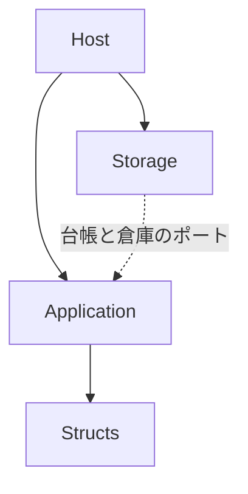
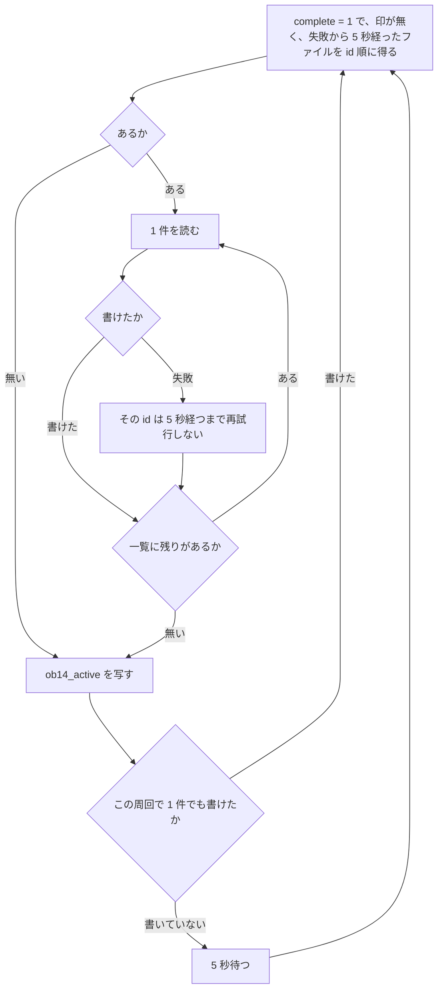
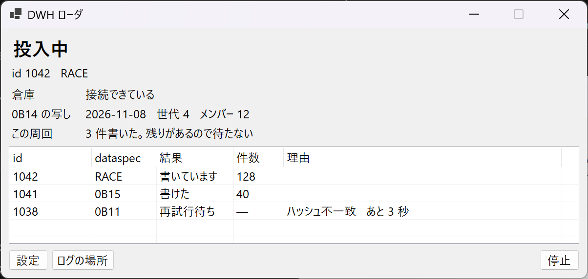
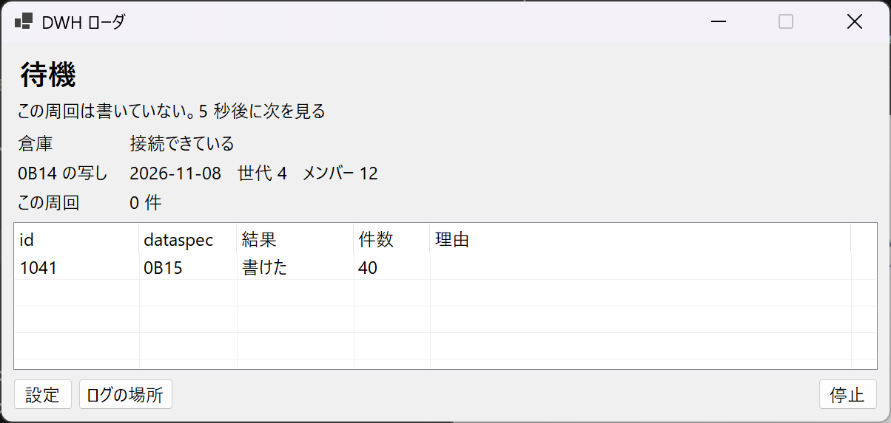
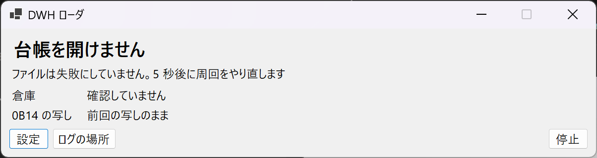
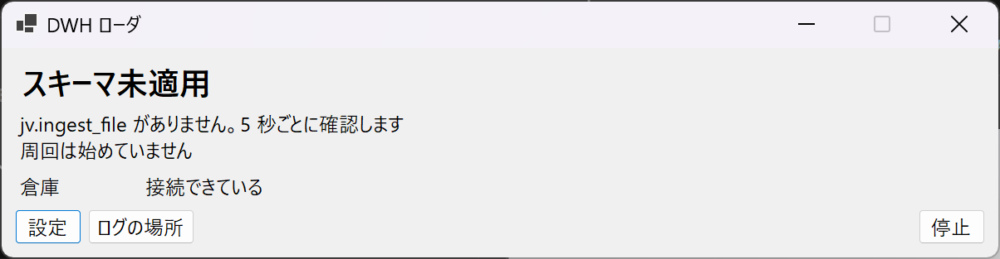
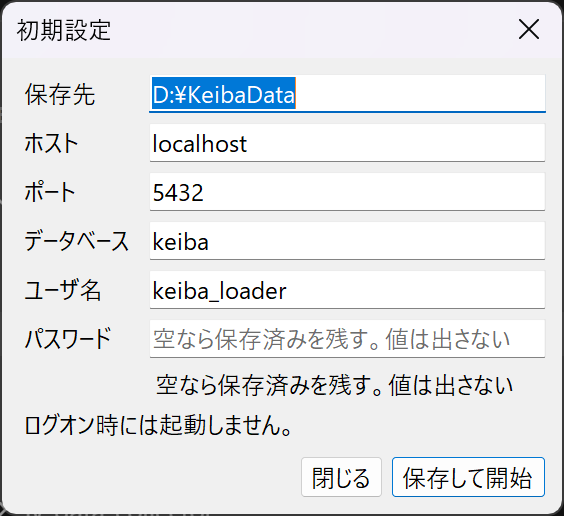
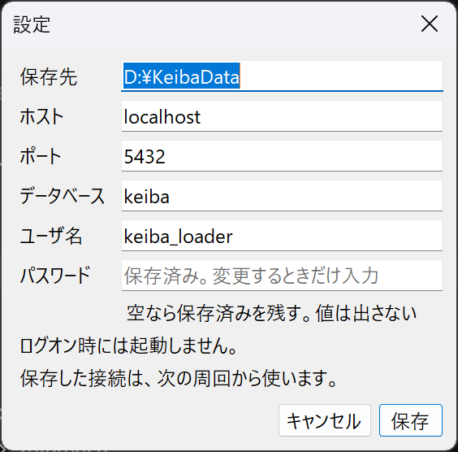

# DWH ローダ 設計

- 状態: ドラフト
- 日付: 2026-11-08
- 全体の要求: [../requirements.md](../requirements.md)
- 全体の構造: [../architecture.md](../architecture.md)
- 要求: [requirements.md](requirements.md)
- 構造: [architecture.md](architecture.md)
- PostgreSQL: [postgresql.md](postgresql.md)
- データベース定義書: [schema.md](schema.md)
- 入力の形式: [../jv-data-collector/design.md](../jv-data-collector/design.md)
- 正とする公式版: 収集アプリの設計が挙げる JV-Data 仕様書 Ver.4.9.0.1 と、SDK の C# 構造体

この文書は、要求を満たすための追随、完了ファイルの読み方、展開、書き込み、画面、受入条件を定義する。プロセスの境界は [architecture.md](architecture.md)。テーブルと有効な版は [schema.md](schema.md)。レコードのバイト定義は公式仕様書を正とし、ここでは再定義しない。

## 1. 結論

ローダは、収集アプリとは別の C# プロセスである。状態の窓と設定の窓を持つ。通知領域には置かない。Windows サービスにはしない。起動は `DwhLoader.exe` の実行であり、ログオン時の登録はしない。動いているあいだ、完了ファイルを周回で読む。ターゲットフレームワークは `net10.0-windows`、プロセスは x64、公開は `win-x64` の自己完結フォルダとする。収集アプリの x86 とは別に決める。COM と JV-Link は呼ばない。窓は Windows Forms とし、ホストだけが持つ。

完了の正は台帳の `raw_file.complete = 1` である。ローダは台帳を読み取り専用で開き、まだ `jv.ingest_file` に無い完了ファイルを id の順に読む。1 ファイルを PostgreSQL の 1 トランザクションで書き、同じトランザクションで `ingest_file` に印を付ける。印があるファイルは読まない。

版は消さない。推奨キーが同じ行が複数あっても、すべて残す。どの版を有効にするかは [schema.md](schema.md) のビューが決める。`0B14` の有効世代はファイルの印とは別に、毎周回 `jv.ob14_active` へ写す。世代だけの切り替えでは raw が増えないためである。

馬券予想モデルは起動しない。予想が読むビューへ行が入り、写しが終わるところまでがローダの仕事である。

## 2. 実装の枠

ソリューションは `src/DwhLoader/DwhLoader.slnx`。言語は C#。接続は Npgsql。台帳は `Microsoft.Data.Sqlite`。構造体は SDK の C# 版で、収集アプリは参照しない。

| プロジェクト | 役割 |
| --- | --- |
| `DwhLoader.Host` | ミューテックス、設定、周回の待ち、ログ、状態の窓、設定の窓 |
| `DwhLoader.Application` | ファイルの選択、展開、値の置き方、写しの中身。SQL を持たない |
| `DwhLoader.Storage` | 台帳の読み取りと PostgreSQL への書き込み。Application のポートを実装する |
| `DwhLoader.Structs` | SDK 5.0.0 の C# 構造体定義 `JVData_Struct.cs` をコンパイルする |
| `DwhLoader.Tests` | JV-Link を使わない自動テスト |



`DwhLoader.Structs` はサンプルのエントリ ポイントを含めない。構造体定義は SDK 5.0.0（64bit）の C# 版 `JVData_Struct.cs` をプロジェクトへコピーし、`docs/reference` はコンパイルに使わない。公開フォルダに SDK の zip、仕様書、JV-Link は入れない。

公開単位は `win-x64` の自己完結フォルダとする。単一ファイルにはしない。`Microsoft.Data.Sqlite` のネイティブ ライブラリを同じフォルダに置く。インストール先は次の固定パスである。

`%LocalAppData%\Programs\KeibaDwh\Loader\`

実行ファイル名は `DwhLoader.exe`。二重起動は名前付きミューテックス `Local\KeibaDwh.Loader` で拒む。後発は終了コード 0 で終わる。

公開と、インストール先へのミラーは、リポジトリのルートで次を実行する。

```powershell
powershell -NoProfile -ExecutionPolicy Bypass -File .\scripts\deploy-loader.ps1
```

スクリプトは、`dotnet publish` で `%TEMP%\KeibaDwh.Loader.publish` へ出し、インストール先だけを `robocopy /MIR` する。`dotnet build` の出力はコピーしない。`%AppData%`、`DataRoot`、PostgreSQL は対象にしない。配置のあと exe は起動しない。`DwhLoader` が実行中のときは、状態の窓の「停止」を待つ。プロセスは止めない。待ちをやめるときは Ctrl+C でスクリプトを止める。終了したあとに公開を始める。ファイルがロックされたままのときは、再試行 2 回のあと失敗で終わる。

`robocopy` の終了コードが 0 から 7 のとき、スクリプトの終了コードは 0 である。8 以上はその終了コードのまま失敗である。公開結果に `DwhLoader.exe` と `e_sqlite3.dll` が無いときも失敗である。

## 3. 周回

起動は `DwhLoader.exe` の実行である。`HKCU\Software\Microsoft\Windows\CurrentVersion\Run` には書かない。設定またはパスワードが無いとき、および知らないキーがあるときは、設定の窓を開く。周回は始めない。保存せずにその窓を閉じると、終了コード 1 で終わる。



待機が 5 秒なのは、完了になってから次の周回がファイルを見る間隔を、開催日の速報に合わせるためである。書けたファイルがあるあいだは待たない。初回の積み残しも同じ周回で、id の順に追いつく。一括モードは置かない。

台帳または PostgreSQL を開けない周回は、ファイルを失敗にせず、5 秒待って周回ごとやり直す。停止のときは、開いているトランザクションをロールバックしてからプロセスを終える。

投入は 1 本である。ファイルを並列に書かない。

## 4. 1 ファイルの読みと書き

読む台帳オブジェクトは次だけである。

| オブジェクト | 使い方 |
| --- | --- |
| `raw_file` | `complete = 1` の id、dataspec、パス |
| `published_record` | そのパスの索引。`seq` の順 |
| `ob14_active` と `record_index` | 写し用の開催日、世代、種別、SHA-256 |

水位、実行履歴、再開カーソルは読んでも更新しない。

接続は `Mode=ReadOnly` と `PRAGMA query_only=ON`、`busy_timeout=5000` とする。台帳ファイルが無いときは作らない。ファイル 1 件ごとに読み取りを開き、索引をメモリへコピーしてから閉じる。PostgreSQL へ書いているあいだは台帳のトランザクションを持たない。索引の一覧はファイル単位で持つ。ペイロードは 1 件ずつ読む。

切り出しの正は索引の `offset` と `length` である。`offset` はペイロードの位置、`length` はペイロード長である。ファイルを先頭からフレーム分割し直さない。raw は読み取りで開き、共有は読み書き両方を許す。

読んだバイトの SHA-256 が索引と一致するときだけ展開する。一致しない、または `offset` がファイルの末尾を超えるときは、そのファイルのトランザクションを捨て、`ingest_file` に書かない。

PostgreSQL は 1 ファイルを 1 トランザクションにする。親、子、`unparsed`、`ingest_file` を同じトランザクションで入れる。コマンドのタイムアウトは設けない。接続のタイムアウトは 15 秒とする。検索パスは `jv` とし、SQL もスキーマを修飾する。

主キーが既にある行は挿入しない。既にある行は更新しない。

## 5. 展開

種別とテーブルの対応、主キー、子、配列、値の置き方は [schema.md](schema.md) を正とする。この設計では表を写さない。

1. 索引の `record_id` と、ファイルの dataspec を使う。dataspec はペイロードの中には無い。
2. キーの形が schema にある種別は、ペイロード長が一致する SDK 構造体で切る。桁拡張の対象は schema の表で、一致した方が拡張後なら `layout_rev = 1`、拡張前なら `0` とする。桁拡張の対象でない種別は `layout_rev = 0`。
3. キーの形が schema にまだ無い種別と、一覧に無い種別は `jv.unparsed` へ入れる。ファイルの投入は成功にする。`record_id` は台帳の値をそのまま使う。
4. 一覧にあり、キーの形もある種別に、一致する構造体長が無いときは、そのファイルを失敗にする。`unparsed` には入れない。

`make_ymd` は 8 文字のまま主キーに入れる。暦日なら `make_date` に同じ日を入れ、`00000000` と空白は `make_date` だけを NULL にする。他の年月日も schema の値の置き方に従い、空白と `00000000` は NULL にする。

文字は全角を Shift_JIS、半角を JIS8 として UTF-8 にする。名称は末尾の空白だけ除く。全項目が `0`、半角空白、全角空白の値は NULL にする。数字でない記号は NULL にし、理由の列が schema にある項目だけ理由を残す。

繰り返しで頭や組番の並びは子テーブルへ入れる。初期値だけの枠は行にしない。本賞金、ラップ、着回数のように位置が意味を持つ固定長は、空の枠も含めて親の配列列にする。親を入れてから子を入れる。

データ区分 `0` も行として残す。有効ビューから除くのは schema のビューである。特別登録馬の区分 `1` と区分 `2` も両方残す。

速報と `RACE` のどちらを有効にするかは、挿入時には決めない。`src_dataspec` を残し、`v_race_program` と `v_race_result` の採り方が優先を表す。`0B16` も行として残す。開催日に有効な `0B14` 世代があるときにどちらを出すかは、ビューが `ob14_active` を見て決める。

発表月日時分の列は `happyo_ts char(12)` とする。仕様の 12 桁をそのまま入れ、空でも NULL にしない。

`collected_at` は索引の `acquired_utc` である。台帳は UTC のラウンドトリップ形式で持つ。`loaded_at` は PostgreSQL の `now()` とする。

## 6. 0B14 の写し

写しは、その周回のファイルを入れ終えたあと、ファイルの成否とは別に行う。対象が 0 件の周回でも行う。同一バイトの再送は収集側が追記しないため、世代だけが進むことがある。

手順は次である。

1. 台帳から、`ob14_active` に属する行の開催日、世代番号、`record_id`、SHA-256 を全部読む。`record_index` を結合してハッシュと種別を取る。
2. 読み取りに失敗した周回は、PostgreSQL 側の前回の写しを残す。
3. 読み取りに成功したら、メンバーが 0 件でも、1 トランザクションで `jv.ob14_active` を全削除してから挿入する。開催日が暦日でないメンバーがあるときは、このトランザクションを捨て、前回の写しを残す。
4. 過去の世代は PostgreSQL に残さない。履歴は台帳が持つ。

ファイルの完了が見えてから、収集側が世代を有効にするまでにずれがある。写したあとに世代が進んでいたら、次の周回の写しで追いつく。そのためにファイルは読み直さない。

列は [schema.md](schema.md) の取り込み台帳を正とする。

## 7. 再解釈

定常の追随は、`ingest_file` に id が無い完了ファイルだけを読む。スキーマを変えて同じ raw から作り直すときは、ローダを止める。スーパーユーザが `jv` の行を空にする。テーブル定義とビューは残す。そのあとローダを再び起動する。起動時に `ingest_file` が空なら、完了ファイルを id 順に入れ直す。自動では読み直さない。

`unparsed` に入れた既知の種別へ表ができたときも、この手順で親テーブルへ入れ直す。

## 8. 設定とロール

設定ディレクトリは `%AppData%\KeibaDwh\Loader\`。`config.json` は UTF-8 とする。キーは次だけを認める。知らないキーがあるときは周回を始めず、設定の窓にその名前だけを出す。値は出さない。

| キー | 値 |
| --- | --- |
| `dataRoot` | 収集アプリの DataRoot。ローダは収集アプリの `config.json` を読まない |
| `host` | `localhost` |
| `port` | `5432` |
| `database` | `keiba`。この PC の競馬データ倉庫。ローダが書くのは、その中のスキーマ `jv`（JRA-VAN Data Lab. の JV-Data）だけ |
| `username` | `keiba_loader` |

パスワードは `config.json` に書かない。`db-password.bin` に DPAPI の CurrentUser で置く。`DwhLoader.exe --set-password` はコンソールからパスワードを読み、このファイルを書いて終了する。周回は始めない。ログと画面にパスワードと接続文字列を出さない。

ローダは起動時にテーブルを作らない。`jv.ingest_file` が無いときは、スキーマ未適用として周回を始めず、5 秒ごとに確認し直す。定義の適用はスーパーユーザが行う。

ログインロールは `keiba_loader` とする。スーパーユーザにはしない。データベースを作る権限は渡さない。初回は `psql` で次を実行する。パスワードは `\password keiba_loader` で決め、コマンドラインには書かない。

```sql
CREATE ROLE keiba_loader LOGIN;
GRANT CONNECT ON DATABASE keiba TO keiba_loader;
GRANT USAGE ON SCHEMA jv TO keiba_loader;
GRANT SELECT, INSERT ON ALL TABLES IN SCHEMA jv TO keiba_loader;
GRANT DELETE ON TABLE jv.ob14_active TO keiba_loader;
ALTER DEFAULT PRIVILEGES IN SCHEMA jv GRANT SELECT, INSERT ON TABLES TO keiba_loader;
```

この GRANT は、[schema.md](schema.md) のテーブルを作ったあとに実行する。`ALTER DEFAULT PRIVILEGES` は、それを実行したスーパーユーザが以後作る表の SELECT と INSERT に効く。`ob14_active` を作り直したあとは DELETE を付け直す。ローダが実行する書き込みは、スキーマ `jv` の親と子と `ingest_file` と `unparsed` への INSERT と、`ob14_active` の DELETE と INSERT だけである。別の競馬データ用にスキーマを足しても、このロールの権限は `jv` のままである。

## 9. 画面

状態の窓は、実行ファイルの起動で開く。設定が揃っているときだけ周回を始める。最小化しても周回は続く。閉じる、および「停止」は、開いているトランザクションをロールバックして終了コード 0 で終わる。通知領域のアイコンは置かない。二重起動の後発は窓を出さず、終了コード 0 で終わる。

先頭行は、次のどれか一つである。

| 先頭行 | いつ |
| --- | --- |
| 投入中 | 1 件を書いている |
| 追随 | この周回で書けたファイルがあり、待たずに次の周回へ入る |
| 待機 | この周回で 1 件も書いていない。5 秒後に次を見る |
| 台帳を開けません | ファイルは失敗にしない。5 秒後に周回ごとやり直す |
| PostgreSQL に届きません | ファイルは失敗にしない。5 秒後に周回ごとやり直す |
| スキーマ未適用 | `jv.ingest_file` が無い。5 秒ごとに確認し、周回は始めない |

倉庫の行は「接続できている」「届かない」「確認していません」のどれかである。ホスト、ポート、データベース名、ユーザ名、パスワード、接続文字列は状態の窓に出さない。

一覧は、今書いているファイルと、この起動で最後に扱ったファイルである。列は台帳の id、dataspec、結果、件数、理由。理由は例外の型、SQLSTATE、メッセージに限る。再試行待ちの行は、残り秒も出す。パス、ペイロード、ハッシュ、パスワード、接続文字列は出さない。

`0B14` の写しは、開催日、世代番号、メンバー件数、または「前回の写しのまま」を出す。ハッシュは出さない。

ボタンは「設定」「ログの場所」「停止」である。ログの場所は `%AppData%\KeibaDwh\Loader\logs\` を開く。

```text
┌ DWH ローダ ──────────────────────────────────────────────────────────┐
│ 投入中                                                               │
│ id 1042   RACE   128 行                                              │
│                                                                      │
│ 倉庫          接続できている                                         │
│ 0B14 の写し   2026-11-08   世代 4   メンバー 12                      │
│ この周回      3 件書いた。残りがあるので待たない                     │
│                                                                      │
│ id     dataspec   結果          件数   理由                          │
│ 1042   RACE       書いています  128                                  │
│ 1041   0B15       書けた        40                                   │
│ 1038   0B11       再試行待ち    —      ハッシュ不一致   あと 3 秒    │
│                                                                      │
│ [設定] [ログの場所]                                       [停止]     │
└──────────────────────────────────────────────────────────────────────┘
```



待機は同じ窓で、先頭とこの周回の行が変わる。台帳を開けないときは倉庫を「確認していません」とし、PostgreSQL に届かないときは倉庫を「届かない」とする。どちらも一覧を出さず、写しは「前回の写しのまま」である。スキーマ未適用のときは接続できていて、一覧は出さない。

```text
┌ DWH ローダ ──────────────────────────────────────────────────────────┐
│ 待機                                                                 │
│ この周回は書いていない。5 秒後に次を見る                             │
│                                                                      │
│ 倉庫          接続できている                                         │
│ 0B14 の写し   2026-11-08   世代 4   メンバー 12                      │
│ この周回      0 件                                                   │
│                                                                      │
│ id     dataspec   結果     件数   理由                               │
│ 1041   0B15       書けた   40                                        │
│                                                                      │
│ [設定] [ログの場所]                                       [停止]     │
└──────────────────────────────────────────────────────────────────────┘
```



```text
┌ DWH ローダ ──────────────────────────────────────────────────────────┐
│ 台帳を開けません                                                     │
│ ファイルは失敗にしていません。5 秒後に周回をやり直します             │
│                                                                      │
│ 倉庫          確認していません                                       │
│ 0B14 の写し   前回の写しのまま                                       │
│                                                                      │
│ [設定] [ログの場所]                                       [停止]     │
└──────────────────────────────────────────────────────────────────────┘
```



```text
┌ DWH ローダ ──────────────────────────────────────────────────────────┐
│ スキーマ未適用                                                       │
│ jv.ingest_file がありません。5 秒ごとに確認します                    │
│ 周回は始めていません                                                 │
│                                                                      │
│ 倉庫          接続できている                                         │
│                                                                      │
│ [設定] [ログの場所]                                       [停止]     │
└──────────────────────────────────────────────────────────────────────┘
```



| 操作 | すること |
| --- | --- |
| 設定 | 設定の窓を開く。周回は止めない |
| ログの場所 | ログのフォルダを開く |
| 停止 | 開いているトランザクションをロールバックし、終了コード 0 で終わる |
| 閉じる | 停止と同じ |
| 最小化 | 周回は続く |

設定の窓は、初期と、状態の「設定」から開く。書くキーは `dataRoot` `host` `port` `database` `username` だけである。パスワード欄はマスクする。空のまま保存したときは、既にある `db-password.bin` を残す。ファイルが無く欄も空なら保存しない。保存済みのパスワードは欄に戻さない。知らないキーがあるときは、保存前にその名前だけを出す。値は出さない。保存は認めるキーだけを書き、知らないキーは残さない。

初期の「保存して開始」で周回を始める。「閉じる」は終了コード 1 で終わる。実行中に開いた「保存」は、次の周回からその接続を使う。開いているトランザクションは、今の接続のまま終える。「キャンセル」は今の設定のまま窓を閉じる。`DwhLoader.exe --set-password` は、コンソールからパスワードを書いて終了し、周回は始めない。ログオン時起動の選択は置かない。

```text
┌ 初期設定 ────────────────────────────────────────────────┐
│ 保存先        [ D:\KeibaData                     ]       │
│ ホスト        [ localhost                        ]       │
│ ポート        [ 5432                             ]       │
│ データベース  [ keiba                            ]       │
│ ユーザ名      [ keiba_loader                     ]       │
│ パスワード    [                                      ]   │
│               空なら保存済みを残す。値は出さない         │
│                                                          │
│ ログオン時には起動しません。                             │
│                                                          │
│                              [閉じる] [保存して開始]     │
└──────────────────────────────────────────────────────────┘
```



```text
┌ 設定 ────────────────────────────────────────────────────┐
│ 保存先        [ D:\KeibaData                     ]       │
│ ホスト        [ localhost                        ]       │
│ ポート        [ 5432                             ]       │
│ データベース  [ keiba                            ]       │
│ ユーザ名      [ keiba_loader                     ]       │
│ パスワード    [                                      ]   │
│               保存済み。変更するときだけ入力             │
│                                                          │
│ 保存した接続は、次の周回から使います。                   │
│                                                          │
│                                [キャンセル] [保存]       │
└──────────────────────────────────────────────────────────┘
```



上の枠と写真の数値とパスは、並びを示す見本である。

## 10. 失敗とログ

ログは `%AppData%\KeibaDwh\Loader\logs\` の 14 日分のローリング ファイルとする。出してよいものは、dataspec、台帳のファイル id、パス、レコード種別、`seq`、件数、例外の型、PostgreSQL の SQLSTATE、メッセージである。出さないものは、パスワード、接続文字列、ペイロード、利用キーである。

同じファイル id と同じ理由の組は、最初の 1 回と、その後は 1 時間に 1 回だけログへ出す。再試行の間隔はログとは別に 5 秒である。

| 状況 | 動作 |
| --- | --- |
| 設定不足、知らないキー | 設定の窓を開く。保存せず閉じると終了コード 1。周回は始めない |
| 二重起動 | 窓を出さず終了コード 0 |
| 台帳が無い、PostgreSQL に届かない | ファイルは失敗にしない。5 秒後に周回ごとやり直す。状態の窓は一覧を出さず、写しは前回のまま |
| `jv.ingest_file` が無い | 周回を始めず、5 秒ごとに確認する |
| ハッシュ不一致、構造体長の不一致、制約違反 | そのファイルをロールバックする。5 秒経つまでその id を再試行しない。他のファイルは続ける。状態の窓に id と理由を出す |
| 停止 | 開いているトランザクションをロールバックして終了コード 0。窓を閉じるときも同じ |

## 11. 受入条件

要求の [できていると言える条件](requirements.md) を、次の手順で確認する。自動テストは `DwhLoader.Tests` に置く。PostgreSQL へ書く確認は、テストが作って捨てるデータベースで行い、`keiba` には書かない。

1. `complete = 1` でない raw からは行を作らない。水位は投入の前後で変わらない。
2. ホスト、ポート、データベース名、ユーザ名はローダの `config.json` にあり、パスワードは `db-password.bin` にある。収集アプリの `config.json` には無い。ログと画面にパスワードと接続文字列が無い。状態の窓にはホスト、ポート、データベース名、ユーザ名も出さない。設定の窓はそれらの項目を出し、パスワードの値は出さない。
3. 同じ推奨キーでデータ作成年月日が違う行を両方残す。有効なビューは作成年月日が新しい方で、同日なら `collected_at` が新しい方である。区分 `0` は表には残り、有効なビューには出ない。
4. `0B14` を 2 世代入れたとき、`jv.ob14_active` と開催情報の有効ビューは 2 回目の世代だけになる。世代だけが進み、新しいファイルが無いときも、次の周回の写しが追従する。`JVRTOpen` の該当なしに相当する、世代を進めない台帳では、写しは前回のままである。
5. 収集アプリが台帳を WAL で開いたまま、ローダが完了ファイルを読める。ローダの接続は読み取り専用で、台帳に書き込まない。
6. ローダを起動したあとでファイルが完了になると、そのファイルのためにプロセスを起動し直さなくても、行が PostgreSQL に入る。同じ台帳 id の 2 回目は行を増やさない。起動しても `Run` にローダの値は無い。
7. ローダは馬券予想モデルを起動しない。投入と写しのあと、予想用のビューを同じデータベースから読める。
8. 索引とペイロードの SHA-256 が違うファイルは、`ingest_file` に残らない。他の完了ファイルは投入される。
9. 一覧に無いレコード種別は `unparsed` に残り、同じファイルの既知の種別は親テーブルに入る。
10. `RACE` の区分 `7` と、作成年月日が新しい `0B15` の速報を両方入れたとき、成績の有効ビューは `RACE` の区分 `7` である。番組の同じ区分では `0B15` が有効になる。
11. 拡張前と拡張後の構造体長を持つ同じ項目が同じ列に入り、`layout_rev` が `0` と `1` になる。

テーブル単位の項目列の確認は、schema が見本以外の項目列を書き終わるまで置かない。

## 12. 今回決めないこと

- バックアップとリストア
- `chakudo` の主キー列名。schema に書き足されるまでは `unparsed` に入り、親テーブルへの入れ直しは再解釈で行う
- コード表の名称テーブル
- 予想の特徴量テーブル、結果の保存先、予想を起動するプロセス
- `race_horse` 以外の索引と、開催日で読むための生成列
