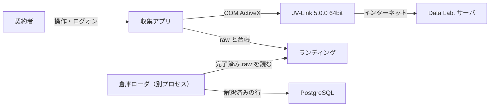
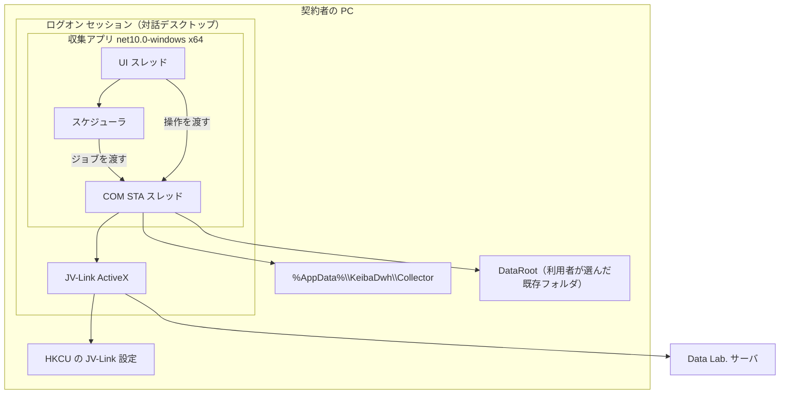
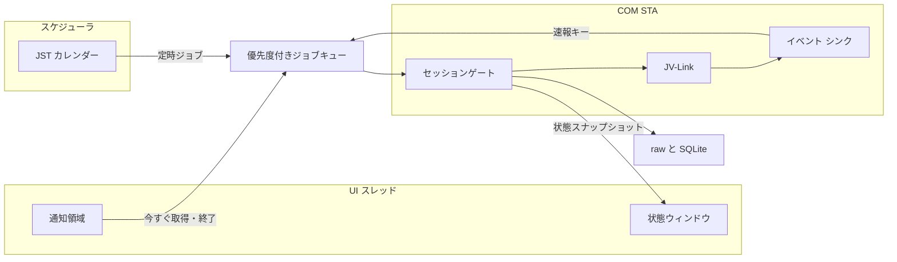
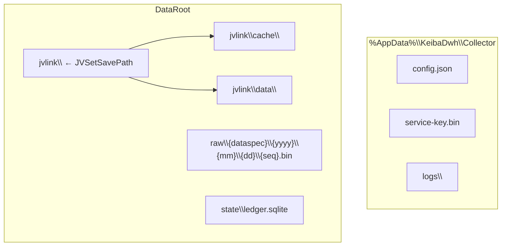
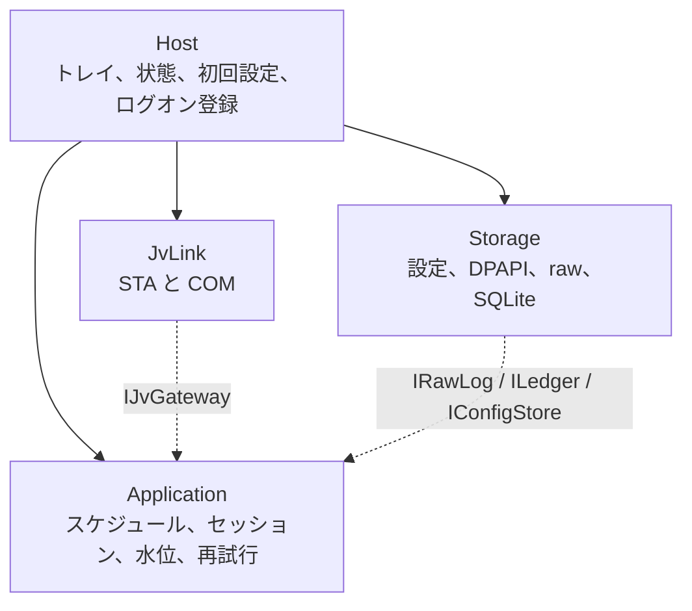
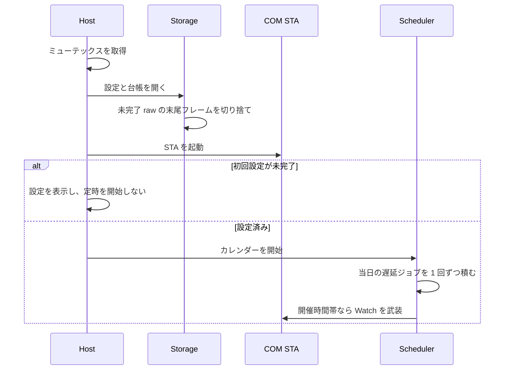
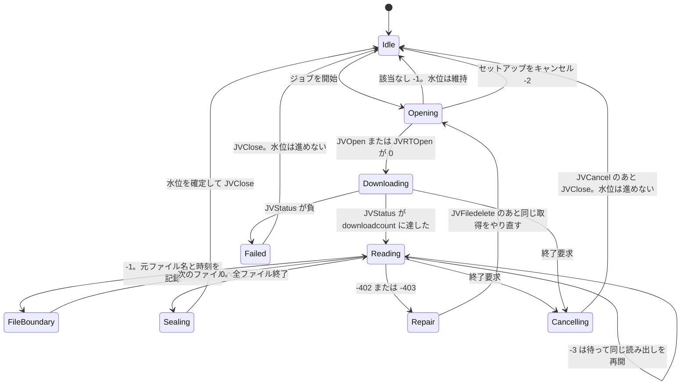
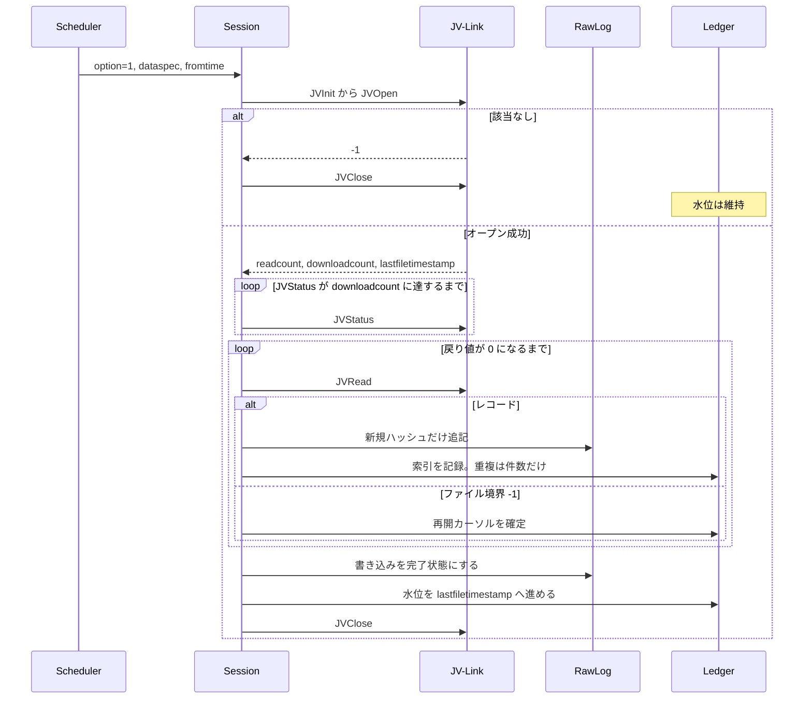

# JV-Data 収集常駐アプリ アーキテクチャ設計

- 状態: ドラフト
- 日付: 2026-11-03
- 全体の要求: [../requirements.md](../requirements.md)
- 全体の構造: [../architecture.md](../architecture.md)
- 要求: [requirements.md](requirements.md)
- 設計: [design.md](design.md)
- デプロイ: [deployment.md](deployment.md)
- ローダ: [../dwh-loader/architecture.md](../dwh-loader/architecture.md)
- 倉庫: [../dwh-loader/warehouse.md](../dwh-loader/warehouse.md)
- 位置づけ: プロセスとモジュールの構造。取得手順、対象データ、保存形式、画面の振る舞い、受入条件は [design.md](design.md)。インストール先と更新は [deployment.md](deployment.md)。レコードのバイト定義は公式仕様書を正とし、ここでは再定義しない。

## 1. 結論

収集アプリは、契約者のログオン セッションで動く C# / Windows Forms の 64bit トレイ アプリ 1 プロセスである。ターゲットフレームワークは `net10.0-windows`（.NET 8 以降のうち現行 LTS の .NET 10）とする。Windows サービスにはしない。

プロセスの中は 4 つのモジュールに分かれる。画面、取得の判断、JV-Link 呼び出し、ランディングへの書き込みは互いに直接参照しない。JV-Link の COM 呼び出しは専用 STA スレッド 1 本に直列化し、`JVOpen` から `JVClose` までのセッションは同時に 1 つだけ開く。

正本はローカルの追記ファイルと SQLite である。解釈済みの行を置く倉庫は PostgreSQL とし、書くのは別プロセスのローダだけである。収集アプリは PostgreSQL へ接続しない。ローダが読むのは、完了フラグの付いた raw だけである。

## 2. 設計方針

| 方針 | 内容 |
| --- | --- |
| 蓄積系 | マスタと過去走は自分で持つ。`TCOV` / `RCOV` / `TCVN` / `RCVN` と option = 2 は取得しない |
| 可逆 | `JVRead` / `JVGets` のバイト列をそのままフレーム化する。文字コード変換、トリム、項目分割はしない |
| 未知レコード | レコード種別 ID が未知でも raw に残す。捨てる判断はローダだけが行う |
| 直列 | COM は STA 1 本。セッションの入れ子と同一 dataspec の並行実行をしない |
| 対話セッション | JV-Link の設定はユーザ レジストリにあり、設定ダイアログは対話デスクトップを要る。Session 0 から呼ばない |
| 水位と重複 | 水位を進めるのは、その `JVOpen` の全ファイルを読み終えたときだけ。同一バイトは SHA-256 で追記しない |
| 復旧 | 異常終了のあと、次回起動の修復だけで再開できる。完了済み raw は書き換えない |
| 秘密 | 利用キーは DPAPI（CurrentUser）で暗号化し、画面とログに出さない |

## 3. システムコンテキスト

収集アプリの相手は、利用者、利用者 PC に入っている JV-Link、JRA-VAN Data Lab. のサーバ、ローカルディスク、別プロセスの倉庫ローダである。Data Lab. への通信は JV-Link が行う。収集アプリは HTTP クライアントを持たない。

スコープの境界:

- アプリが持つもの: スケジュール、水位、可逆保存、常駐、通知領域
- JV-Link が持つもの: 利用規約の同意、サーバとの通信、`cache` と `data` への公式ファイル保存、設定ダイアログ
- ローダが持つもの: 推奨キーによる最新行の決定、2023-08-08 前後のフィールド長、速報と確定成績の優先、`0B14` の最新世代の採用、PostgreSQL へのロード

## 4. システム構成

### 4.1 実行単位

1 台の PC、1 人のログオン セッション、1 プロセス。二重起動は名前付きミューテックス `Local\KeibaDwh.Collector` で拒む。JV-Link の設定画面は同時に開けず、セッションを重ねると `JVOpen` が `-202` になるためである。

プロセスは C#、Windows Forms、x64 に固定し、ビット数は JV-Link と一致させる。ターゲットフレームワークは `net10.0-windows`。初期対象は SDK 5.0.0 の 64bit と、日本語版 Windows 11 である。

ログオン起動は `HKCU\Software\Microsoft\Windows\CurrentVersion\Run` に登録する。登録する実行ファイルは `%LocalAppData%\Programs\KeibaDwh\Collector\JvDataCollector.exe` である。公開と差し替えは [deployment.md](deployment.md)。タスク スケジューラの Session 0 起動や Windows サービスにはしない。ログオン後 1 分以内に常駐し、確定済み水位から再開する。

### 4.2 スレッド

| スレッド | 役割 |
| --- | --- |
| UI | WinForms のメッセージ ポンプ、通知領域、状態ウィンドウ、セットアップ操作。JV-Link を呼ばない |
| スケジューラ | 日本標準時のカレンダー、スリープ復帰の遅延実行、週次の再読込。COM を呼ばず、ジョブをキューへ入れる |
| COM STA | JV-Link の生成、全メソッド呼び出し、`JVWatchEvent` の接続ポイント。ここ以外で COM を触らない |

STA スレッドはメッセージ ポンプを回す。`JVWatchEvent` のコールバックでは `JVRTOpen` を呼ばず、速報ジョブをキューに入れる。コールバックの中で別の Open を始めると、実行中セッションと重なる。

読み出しループは dataspec の境界で高優先の速報ジョブを挟む。1 回の `JVOpen` から `JVClose` の途中では挟まない。

### 4.3 プロセス内の配管

キューの優先度は高い順に、終了、イベント由来の速報、速報の定時（`0B15` `0B14` `0B13` `0B17`）、オッズの周回、利用者の「今すぐ取得」とセットアップ、定時差分である。「今すぐ取得」の待ちは 1 件までとする。実行中の要求が終わってから、その 1 件を始める。

同一 dataspec はキュー上でも実行中でも 1 本にする。単一ゲートだけでも同時実行は起きないが、同じ dataspec を二重に積まないことで、遅延実行と定時実行の重複を避ける。速報で同じ dataspec の取り直しが実行中に重なったときは、その 1 件が終わったあとに 1 回だけ積む。待ちの取り直しは 1 件まで。

### 4.4 配置

| パス | 所有者 | 内容 |
| --- | --- | --- |
| `config.json` | 収集アプリ | 保存先、対象 dataspec、ソフトウェア ID 以外の設定。利用キーそのものは入れない |
| `service-key.bin` | 収集アプリ | `DataProtectionScope.CurrentUser` で暗号化した利用キー |
| `logs\` | 収集アプリ | 14 日分のローリング ログ |
| `DataRoot\jvlink\` | 収集アプリがフォルダを作り、JV-Link が中身を書く | `JVSetSavePath` の対象。配下の `cache` と `data` は JV-Link の作業ファイル |
| `DataRoot\raw\` | 収集アプリ | 追記専用フレーム。日付は取得日。1 ファイル 256 MB で次のファイルへ切る |
| `DataRoot\state\ledger.sqlite` | 収集アプリ | 水位、実行履歴、索引、`0B14` の世代 |

`DataRoot` と `jvlink` は、`JVOpen` の前に存在するディレクトリにする。存在しないパスは `-211` になる。`cache` と `data` は JV-Link が作る。raw と台帳は JV-Link の作業ファイルとは混ぜない。

ディスクの空きが 5 GB 未満のときは新規取得を始めない。既存 raw は削除しない。この状態は通知領域の「要対応」にする。通信の一時失敗では要対応にしない。

## 5. 論理構成

依存は外側から内側へ向かう。Application がポートを定義し、JvLink と Storage がそれを実装する。Host が具象を組み立てる。Application は WinForms と COM を参照しない。

### 5.1 Host

利用者に見える境界。取得判断は持たない。

- 単一インスタンス、構成の組み立て、STA の起動と停止
- 通知領域の 3 状態（待機、取得中、要対応）とメニュー
- 状態ウィンドウへのスナップショット表示。取得中は `JVStatus / downloadcount`
- 初回設定が終わるまでスケジューラを開始しない
- `JVSetUIProperties` をメニューから開く。戻り値 0 はキャンセル、`-100` は失敗
- ログオン起動の登録と解除

### 5.2 Application

JV-Link のバイト列と公式の戻り値だけを知る。レコード項目は知らない。

| 部品 | 責務 |
| --- | --- |
| カレンダー | [design.md](design.md) の取得時刻、開催日、スリープで逃したジョブの当日 1 回の遅延実行 |
| 週次再読込 | 月曜 06:30 に `fromtime` を 7 日前へ戻して読む。確定水位は後退させない |
| セッション | `JVOpen` から `JVClose` までの状態機械。option = 1 と option = 4 と速報で共通 |
| 水位方針 | 全ファイル完了時だけ確定水位を `lastfiletimestamp` へ進める。`-1`（該当なし）では維持する |
| 再開カーソル | 通常データは最後に読み終えたファイルの `m_CurrentFileTimestamp`。セットアップは最後に読み終えたファイル名と `JVSkip` |
| 再試行 | 一時障害は 1 分、5 分、15 分、60 分。同一 dataspec が 6 回失敗したら当日の定時実行を止め、翌日に戻す |
| 速報コーディネータ | 開催時間帯の `JVWatchEvent` 1 本、`0B15` と `0B14` と速報マイニングの取り直し、オッズの 3 分周回、`0B14` の世代切り替え指示 |
| 空き容量 | 新規セッションの開始前に 5 GB を確認する |
| 要対応 | 利用キー拒否、規約未同意、JV-Link 未設定、保存先に書けない、空き容量不足。再試行しない戻り値はここへ上げる |

再試行しないコードとバックオフするコードの一覧は [design.md](design.md) の蓄積データの取得を正とする。`-412` は案内が無い限り環境要因とし、無限リトライにしない。

`COMM` と `MING` は初回の option = 1 で `-116` が返ったら、定時対象から外し、option = 4 のセットアップ対象に残す。結果は台帳に記録し、毎回の定時で探さない。

### 5.3 JvLink

ProgID は `JVDTLabLib.JVLink`。登録が無ければ取得を始めず、SDK の導入案内を出して止まる。

ゲートが外へ出す操作は次に限る。

- 初期化と設定: `JVInit`、`JVSetServiceKey`、`JVSetSavePath`、`JVSetSaveFlag(1)`、`JVSetUIProperties`
- 蓄積: `JVOpen`、`JVStatus`、`JVRead` または `JVGets`、`JVSkip`、`JVCancel`、`JVClose`、`JVFiledelete`
- 速報: `JVRTOpen`、`JVWatchEvent`、`JVWatchEventClose`

`JVSetSaveFlag` は常に 1 とする。利用キーの上書き更新はしない。`-101`（既登録）は成功とみなす。`-101` 以外の利用キー変更は、JV-Link の再インストールが必要な状態として要対応にする。

ソフトウェア ID はアプリ定数とする。64 バイト以内、先頭はスペース以外。ログには全桁を出さない。

### 5.4 Storage

| ポート | 責務 |
| --- | --- |
| `IConfigStore` | `config.json` の読み書き |
| `ISecretStore` | 利用キーの DPAPI 暗号化と復号 |
| `IRawLog` | フレームの追記、256 MB でのローテーション、末尾の中途フレーム切り捨て、完了フラグ |
| `ILedger` | 水位、再開カーソル、実行履歴、索引、`0B14` 世代、dataspec の有効無効 |

フレームの並びは [design.md](design.md) のランディングのとおり、マジック `JVRAW`、ファイル内通し番号、ペイロード長、ペイロード、ペイロードの SHA-256 である。ハッシュ計算は Storage が行う。

### 5.5 ポート

Application が定義するポートは `IJvGateway`、`IRawLog`、`ILedger`、`IConfigStore`、`ISecretStore`、`IClock`、`IAttention` である。`IClock` の現在時刻は `Tokyo Standard Time` に変換してからカレンダーと比較する。台帳に残す時刻は UTC の瞬間とし、`fromtime` の `YYYYMMDDhhmmss` へ変えるときだけ日本標準時にする。日本には夏時間がない。

## 6. 実行モデル

### 6.1 起動

初回設定の完了条件は [design.md](design.md) の初回設定の 5 項目である。COM 登録、利用キー、存在する保存先、対象 dataspec、ログオン起動。このうち 1 つでも欠ける間、定時取得は始めない。利用キーが無い状態は要対応にする。

### 6.2 セッション

蓄積の option = 1、セットアップの option = 4、速報の `JVRTOpen` は同じゲートを通る。違いは開くメソッドと、終了時に水位を進めるかどうかである。速報に蓄積の水位はない。

セットアップ（option = 4）は利用者の開始操作だけで入る。ダイアログは初回だけ出るため、対話セッションで実行する。中断後の再開は、同じパラメータで `JVOpen` し、読み終えたファイル名まで `JVSkip` する。`TOKU` のセットアップは当週と翌週だけであり、過去分は option = 1 で `fromtime` を過去にして取る。

### 6.3 定時差分

1 ジョブは dataspec 1 つである。複数の dataspec を 1 回の `JVOpen` に連結しない。対象ファイルが多いと `JVRead` が遅くなる既知の障害がある。時刻表に複数の dataspec がある枠は、dataspec ごとのジョブを連続して積む。

`fromtime` には、その dataspec と option の確定水位を使う。比較は「指定時刻より大きい」。終了時刻をハイフンで続ける指定はしない。使うと `-1` になる。

週次再読込は `fromtime` だけを 7 日前へ戻す。`JVOpen` が返す `lastfiletimestamp` が現在の確定水位より古いときは、水位をその値で上書きしない。再送バイトはハッシュで吸収する。

### 6.4 速報

開催日は取得済みの `YSCH` で判定する。`YSCH` が空の間は金曜、土曜、日曜を開催側として扱い、取得後にスケジュールへ切り替える。必ず取るのは `0B15`、`0B11`、`0B14`、`0B16`、`0B13`、`0B17` である。契機とキーは [design.md](design.md) の速報を正とする。

木曜 21:00 の `0B15` は、取得済み `YSCH` のこれから来る開催日を取る。`YSCH` が空なら次の金・土・日を取る。金・土・日で開催側の 13:30 に `0B15` と `0B13` と `0B17` を取る。開催日の 8:00 に、監視を張る前に、その開催日の `0B14`、`0B15`、`0B13`、`0B17` を 1 回ずつ取る。これらは水位を進めない。

開催日の 8:00 から 17:30 まで `JVWatchEvent` を 1 本だけ張る。終了時は `JVWatchEventClose` する。コールバックでは `JVRTOpen` せず、ジョブをキューへ入れる。馬体重は `0B11` のあと `0B13` と `0B17`。変更系は `0B16` のあと、その開催日の `0B14` と `0B15`。天候馬場のときは `0B13` と `0B17` も取る。払戻は `0B12` のあと `0B15`。

オッズにイベントはない。金曜発売がある日は金曜 19:00 から 21:00、それ以外は開催日の発走帯に、レースごとに `0B31` から `0B36` と `0B41` `0B42` を 3 分間隔で 1 周する。周回は 1 本に限る。`0B30` は取らない。

`0B14` は、レコードを取得できたときだけ、その開催日の前回世代を無効にし、今回のレコードだけを有効世代にする。`JVRTOpen` の `-1` では世代を動かさない。raw は追記のままで、世代は台帳が持つ。

速報の提供期間は、時系列オッズ（`0B41` `0B42`）が 1 年、それ以外は 1 週間である。確定成績の長期保存は `RACE` が担う。

### 6.5 終了

終了メニュー、ログオフ、シャットダウンでは、実行中セッションにキャンセルを送り、`JVCancel` のあと `JVClose` する。Watch を張っていれば `JVWatchEventClose` する。読み途中の水位は確定しない。未完了 raw は未完了のまま閉じ、次回起動で末尾だけ修復する。完了済みファイルには触らない。

## 7. ランディングとカーソル

論理的な書き込み単位は、JV-Link の元ファイル 1 つである。物理的な raw ファイルは 256 MB までのコンテナで、元ファイルの境界とは一致しない。

カーソルは 2 つある。

| カーソル | 進めるタイミング | 用途 |
| --- | --- | --- |
| 確定水位 | `JVRead` / `JVGets` が 0 を返し、全ファイルを読み終えたあと | 次回の `fromtime` |
| 再開カーソル | 元ファイルの境界（戻り値 -1）を耐久化できたあと | 中断後の `fromtime` または `JVSkip` |

確定水位は再開カーソルより先へ進まない。終了と失敗では確定水位を動かさない。該当なし（`JVOpen` の `-1`）でも動かさない。

索引はフレームを耐久化したあとで台帳へ入れる。ローダから見える索引は、完了フラグの付いた raw に属するものだけである。ファイルを完了にしてから、そのファイルの索引をローダへ公開する。完了後の raw は追記も書き換えもしない。256 MB に達したら完了させ、続きは新しいファイルへ書く。

`0B14` の世代番号はハッシュ重複とは別の列で持つ。同一バイトの再送は追記しないが、世代の切り替えは行う。

起動時の修復:

1. 未完了 raw の末尾を、マジック、長さ、SHA-256 が揃った最後のフレームまで切り詰める
2. 切り詰めた範囲より先を指す索引を削除する
3. フレームがあって索引が無い範囲は、ペイロードからレコード種別 ID と SHA-256 を再計算して索引を補う
4. 再開カーソルから取得を再開する。再送はハッシュで吸収する

元ファイル名と `m_CurrentFileTimestamp` は、境界のたびに台帳へ書く。クラッシュで境界前の末尾だけ索引が欠ける場合、その範囲の出所は補完時に空でよい。同じバイトは再取得のハッシュで吸収される。

## 8. 障害の境界

| 種別 | 例 | 動作 |
| --- | --- | --- |
| 設定・契約 | `-111` から `-116`、`-201`、`-211`、`-301` から `-303`、`-305` | 再試行しない。要対応。定時は始めないか、その dataspec を止める |
| 一時障害 | `-411` `-412` `-413` `-421` `-431` `-502` `-503` `-504` | 1、5、15、60 分で再試行。6 回で当日停止。アイコンは要対応にしない |
| ファイル異常 | `-402` `-403` | `JVFiledelete` のあと、同じ `JVOpen` からやり直す |
| ダウンロード中 | `-3` | 待って同じ読み出しを再開する |
| 該当なし | `JVOpen` の `-1` | 正常。`JVClose` し、水位を維持する |
| 容量 | 空き 5 GB 未満 | 新規取得を止める。要対応。既存ファイルは残す |
| プロセス異常終了 | 電源断、強制終了 | 次回起動の修復と再開カーソルだけで戻す |

サーバ メンテナンス（`-504`）は一時障害に含める。アイコンを要対応へ上げるのは、利用者の操作がないと再開できないときだけとする。

## 9. セキュリティとログ

利用キーは DPAPI の CurrentUser で保護する。JV-Link の設定がユーザ ハイブにあり、プロセスもそのユーザのログオン セッションで動くため、マシン全体の保護範囲にはしない。復号結果は COM 呼び出しの引数にだけ渡し、状態ウィンドウ、例外メッセージ、ログ、ダンプ用の文字列へ入れない。

ログに出さないもの: 利用キー、ソフトウェア ID の全桁、レコード本文、フレームのペイロード。出してよいもの: dataspec、option、戻り値、件数、水位、ファイルパス、例外の型。

ログは 14 日でローリングする。

## 10. ローダとの契約

アプリ間の境界は [../architecture.md](../architecture.md) を正とする。ローダ側の要求と構造は [../dwh-loader/requirements.md](../dwh-loader/requirements.md) と [../dwh-loader/architecture.md](../dwh-loader/architecture.md)。

ローダは収集アプリのプロセスに入れない。読む場所は `DataRoot\raw` と `DataRoot\state\ledger.sqlite` だけである。

ローダが守る条件:

- `complete = 1` の raw だけを読む
- 収集アプリが完了済みファイルを書き換えないことに依存してよい
- 推奨キーとデータ作成年月日、レイアウトの世代差、速報と `RACE` の優先、`0B14` の最新世代はローダが決める

収集アプリが守る条件:

- 完了前のファイルをローダ向けの索引に出さない
- 未知のレコード種別 ID を落としたり、取得を止めたりしない
- 倉庫のテーブルや接続を知らない。接続先の PostgreSQL は [../dwh-loader/warehouse.md](../dwh-loader/warehouse.md) の決定に従い、ローダだけが使う

## 11. 技術選定

ランタイムと UI は [design.md](design.md) の実装の枠に合わせる。旧要求にあった仮決めは、この章の決定にする。

| 項目 | 決定 |
| --- | --- |
| 言語 | C# |
| ランタイム | .NET 8 以降。実装ターゲットは .NET 10（`net10.0-windows`）、x64 |
| UI | Windows Forms。`NotifyIcon` と状態ウィンドウ |
| COM | 登録済みの `JVDTLabLib.JVLink`。専用 STA |
| 台帳 | SQLite。WAL。アプリとローダが同時に読めるようにする |
| 倉庫 | PostgreSQL。ローダが書く。収集アプリは接続しない |
| 設定 | `%AppData%\KeibaDwh\Collector\config.json` |
| 秘密 | DPAPI CurrentUser |
| ログオン起動 | HKCU の Run |
| 時刻 | 内部は UTC、JV-Link との境界とカレンダーは日本標準時 |
| ソリューション | `JvDataCollector.Host`、`JvDataCollector.Application`、`JvDataCollector.JvLink`、`JvDataCollector.Storage` |

SDK に含まれる C# の構造体はローダが使う。収集アプリは構造体へバイト列を展開しない。

## 12. 決定一覧

| ID | 決定 |
| --- | --- |
| AD-01 | プロセスはログオン セッションのトレイ アプリ 1 つ。サービスにしない |
| AD-02 | C#、Windows Forms、x64、`net10.0-windows`。JV-Link 64bit と対にする |
| AD-03 | COM は STA 1 本。セッションは同時に 1 つ。イベント コールバックはキューへ入れるだけ |
| AD-04 | 定時の 1 ジョブは dataspec 1 つ。dataspec の境界でのみ速報を挟む |
| AD-05 | 確定水位と再開カーソルを分け、中断時は確定水位を進めない |
| AD-06 | JV-Link の `cache` / `data` と、収集アプリの `raw` / `state` をディレクトリで分離する |
| AD-07 | 利用キーは DPAPI CurrentUser。設定 JSON とログに平文を置かない |
| AD-08 | ローダは別プロセス。公開条件は完了済み raw と、それを指す索引だけ |
| AD-09 | `COMM` / `MING` の option = 1 可否は初回の `-116` で決め、台帳に残す |
| AD-10 | 二重起動をミューテックスで拒む |
| AD-11 | 倉庫は PostgreSQL。収集アプリは接続文字列とスキーマを持たない |

## 13. 続章

この章では次を定義しない。

- SQLite のテーブル、インデックス、公開ビューの DDL
- PostgreSQL のテーブル定義。データベースの採用は [../dwh-loader/warehouse.md](../dwh-loader/warehouse.md) を正とする
- 状態ウィンドウと初回設定の画面項目、操作遷移。並びは [requirements.md](requirements.md)、振る舞いは [design.md](design.md)
- `IJvGateway` のメソッドシグネチャと、戻り値の内部表現
- カレンダーの設定ファイル スキーマ。時刻の初期値は [design.md](design.md) の提供タイミングを正とする
- テストの手順。受入条件は [design.md](design.md) を正とする
- インストール先、公開、更新、削除。正本は [deployment.md](deployment.md)
