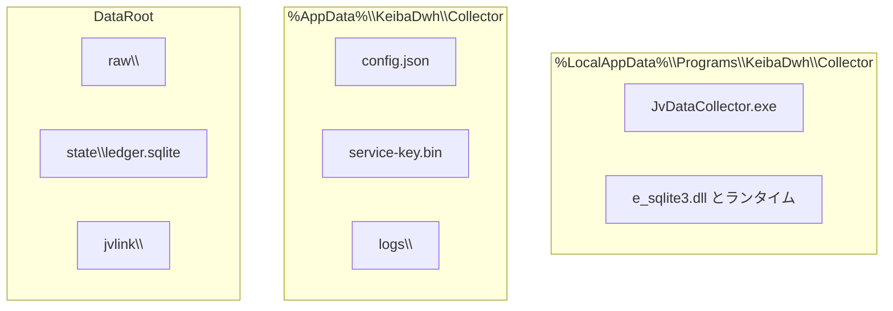
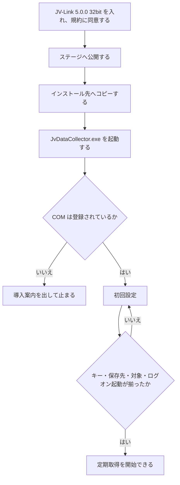
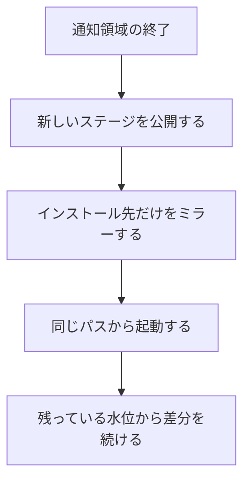

# JV-Data 収集常駐アプリ デプロイ

- 状態: ドラフト
- 日付: 2026-11-03
- 全体の要求: [../requirements.md](../requirements.md)
- 全体の構造: [../architecture.md](../architecture.md)
- 要求: [requirements.md](requirements.md)
- 構造: [architecture.md](architecture.md)
- 設計: [design.md](design.md)
- マニュアル: [manual.md](manual.md)
- ローダ: [../dwh-loader/architecture.md](../dwh-loader/architecture.md)
- 位置づけ: 収集アプリのバイナリを、契約者本人の PC に置き、差し替え、消す手順。プロセス分割は [architecture.md](architecture.md)。取得手順と保存形式は [design.md](design.md)。ローダのインストールは対象外。レコードのバイト定義は公式仕様書を正とし、ここでは再定義しない。

## 1. 結論

収集アプリは、契約者本人の日本語版 Windows 11 に、管理者権限なしの自己完結フォルダとして置く。インストーラは使わない。公開単位は `win-x86` のディレクトリで、単一ファイルにはしない。.NET 10 デスクトップ ランタイムはフォルダに同梱する。

インストール先は次の固定パスである。

`%LocalAppData%\Programs\KeibaDwh\Collector\`

ログオン起動は、初回設定が `JvDataCollector.exe` のフルパスと `--background` を `HKCU\Software\Microsoft\Windows\CurrentVersion\Run` に書く。`--background` では「ホーム」を開かない。設定、利用キー、生データ、台帳はインストール先の外にあり、差し替えでも削除でも触らない。

前提は、利用者が別に入れた公式の JV-Link 5.0.0 32bit だけである。JV-Link、利用キー、JV-Data は同梱しない。

## 2. 配置



| パス | 差し替え | 削除 | 内容 |
| --- | --- | --- | --- |
| `%LocalAppData%\Programs\KeibaDwh\Collector\` | 終了したあと、フォルダごと置き換える | 消す | 自己完結の公開結果。`JvDataCollector.exe`、同梱ランタイム、`e_sqlite3.dll`、pdb |
| `%AppData%\KeibaDwh\Collector\` | 残す | 残す | `config.json`、DPAPI で暗号化した利用キー、14 日分のログ |
| `DataRoot` | 残す | 残す | `raw`、`state\ledger.sqlite`、JV-Link の `jvlink` |

`Program Files` には置かない。そこへ書くには昇格が要る。収集アプリの登録はユーザ ハイブと DPAPI の CurrentUser に閉じている。マニフェストの `requestedExecutionLevel` は `asInvoker` のままとする。

インストール先に設定、利用キー、raw、台帳を置かない。更新時にこのフォルダをミラーするので、データが混ざると消える。

`service-key.bin` を復号できるのは、暗号化したときと同じ PC の同じ Windows ユーザだけである。インストール先や `%AppData%` を別 PC へコピーしても、利用キーは戻らない。raw と台帳はファイルとしてコピーできる。コピー先では JV-Link の導入と、利用キーの入れ直しが要る。

## 3. 公開

リポジトリのルートで、ステージ用ディレクトリへ公開する。

```powershell
$stage = Join-Path $env:TEMP "KeibaDwh.Collector.publish"
if (Test-Path $stage) { Remove-Item $stage -Recurse -Force }
dotnet publish src/JvDataCollector/JvDataCollector.Host/JvDataCollector.Host.csproj `
  -c Release `
  -r win-x86 `
  --self-contained true `
  -p:PublishSingleFile=false `
  -o $stage
```

RID は `win-x86` だけとする。`PlatformTarget` は x86 のままである。`win-x64` と AnyCPU は公開しない。公式の 32bit `JVDTLab.JVLink` と対にならない。

自己完結にするのは、利用者に足す導入物を JV-Link だけにするためである。ランタイムの修正は、アプリを出し直してこのフォルダへ取り込む。デスクトップ ランタイムの別導入は前提にしない。

単一ファイルにしないのは、`Microsoft.Data.Sqlite` の `e_sqlite3.dll` を公開フォルダに置き、常駐中の中身をその場で見るためである。障害調査のため、pdb も同じフォルダに残す。この公開結果は契約者の PC に手元からコピーする。署名、SmartScreen 対策、配信サーバは使わない。

公開結果に次が入っていること。

- `JvDataCollector.exe`
- `e_sqlite3.dll`
- 自己完結のランタイム一式

入っていてはいけないもの。

- JV-Link のインストーラとバイナリ
- 利用キー、`service-key.bin`、`config.json`
- raw、`ledger.sqlite`、JV-Data
- 公式 SDK。正本の置き場は [../reference/](../reference/)

### 手元のコマンド

公開と、インストール先へのミラーを続けるときは、リポジトリのルートで次を実行する。

```powershell
powershell -NoProfile -ExecutionPolicy Bypass -File .\scripts\deploy-collector.ps1
```

スクリプトは、この節の `dotnet publish` と [4. 初回](#4-初回) の `robocopy /MIR` を順に行う。`dotnet build` の出力はコピーしない。ステージは `%TEMP%\KeibaDwh.Collector.publish` である。コピー先はインストール先だけである。`%AppData%` と `DataRoot` は対象にしない。配置のあと、スクリプトは exe を起動しない。起動は次である。

```powershell
Start-Process (Join-Path $env:LOCALAPPDATA "Programs\KeibaDwh\Collector\JvDataCollector.exe")
```

`JvDataCollector` という名前のプロセスが実行中のときは、通知領域の「終了」を待つ。プロセスは止めない。待ちをやめるときは Ctrl+C でスクリプトを止める。終了したあとに公開を始める。ファイルがロックされたままのときは、再試行 2 回のあと失敗で終わる。

`robocopy` の終了コードが 0 から 7 のとき、スクリプトの終了コードは 0 である。8 以上はその終了コードのまま失敗である。公開結果に `JvDataCollector.exe` と `e_sqlite3.dll` が無いときも失敗である。

## 4. 初回



1. 利用者が公式の JV-Link 5.0.0 32bit を入れ、利用規約に同意する。収集アプリはこれを同梱しない。COM が無い PC では取得を始めず、導入案内を出して止まる。
2. [3. 公開](#3-公開) のコマンドでステージを作る。公開と次のコピーをまとめるときは、[手元のコマンド](#手元のコマンド) を使う。
3. インストール先を作り、ステージの中身をコピーする。手元のコマンドを使ったときは、このコピーも済んでいる。

```powershell
$dest = Join-Path $env:LOCALAPPDATA "Programs\KeibaDwh\Collector"
New-Item -ItemType Directory -Force -Path $dest | Out-Null
robocopy $stage $dest /MIR
```

`robocopy` の終了コード 0 から 7 はコピー成功である。8 以上は失敗である。

4. 次で `JvDataCollector.exe` を起動する。作業ディレクトリはインストール先とは限らない。初回設定が利用キー、存在する保存先、ログオン起動を揃えるまで、定期取得は始まらない。取得する種類と時刻は標準のスケジュールで始まり、メニューの「蓄積データ」と「開催日の速報」で変える。

```powershell
Start-Process (Join-Path $env:LOCALAPPDATA "Programs\KeibaDwh\Collector\JvDataCollector.exe")
```
5. Run に書く値は、バージョンを含まない次のコマンドである。`--background` はログオン時に「ホーム」を開かないための引数である。

`"%LocalAppData%\Programs\KeibaDwh\Collector\JvDataCollector.exe" --background`

開発中の `dotnet run` や `bin\Debug` は Run に書かない。登録すると、ログオンのたびに開発出力が常駐する。

アプリ自身の COM 登録はしない。生成するのは、JV-Link のインストーラが登録した ProgID だけである。

## 5. 更新

実行中の exe はロックされている。差し替えの前に、通知領域の「終了」でセッションを区切る。終了は実行中の取得を `JVCancel` のあと `JVClose` し、読み途中の水位を確定しない。強制終了でロックだけ外して差し替えない。



1. 「終了」で常駐を終える。スクリプトを先に起動したときは、スクリプトがこの終了を待つ。
2. [手元のコマンド](#手元のコマンド) を実行する。公開とミラーを分けて行うときは、[3. 公開](#3-公開) のあと、次のコピーを行う。
3. [4. 初回](#4-初回) と同じ `robocopy $stage $dest /MIR` で、インストール先だけを置き換える。`%AppData%` と `DataRoot` は対象にしない。手元のコマンドを使ったときは、このコピーも済んでいる。
4. [手元のコマンド](#手元のコマンド) と同じ起動コマンドで、同じ exe パスから起動する。水位と `service-key.bin` はそのまま続きになる。

Run のパスは変えない。インストール先にバージョン番号のディレクトリを挟まない。

ローダの読み取り先は `DataRoot` のままである。収集アプリの差し替えで、完了済み raw と台帳の場所は変わらない。

## 6. 削除と移動

削除で消すもの:

- `%LocalAppData%\Programs\KeibaDwh\Collector\`
- `HKCU\Software\Microsoft\Windows\CurrentVersion\Run` に登録した、この exe の値

残すもの:

- `%AppData%\KeibaDwh\Collector\`
- `DataRoot`

生データと台帳はローダが読む正本である。利用者が明示したときだけ、`%AppData%` と `DataRoot` を消す。

同じ PC の同じユーザへ入れ直したときは、残っている `service-key.bin` と台帳から続きになる。別 PC へ移すときは、raw と台帳をコピーし、利用キーは移った先で入れ直す。`config.json` の保存先が移った先のドライブと違うときは、初回設定で保存先を直す。

対象は 1 台の PC の 1 人のログオン セッションである。ユーザごとの `%AppData%`、HKCU、DPAPI CurrentUser をまたいだ配置はしない。

## 7. アプリが守ること

- 読み書きのパスは、exe の位置、`%AppData%`、`DataRoot` から決める。Run から起動したときの作業ディレクトリに依存しない。
- ログオン起動に登録するのは、このインストール先の `JvDataCollector.exe --background` だけである。
- マニフェストは `asInvoker` のままとする。管理者への昇格を要求しない。
- アプリ自身を COM 登録しない。
- インストール先へ設定、利用キー、raw、台帳を書かない。

## 8. 対象外

| 方式 | 理由 |
| --- | --- |
| Windows サービス、タスク スケジューラの Session 0 | 対話デスクトップと HKCU の JV-Link 設定が要る。プロセスの決定は [architecture.md](architecture.md) |
| MSIX | レジストリと `%AppData%` の仮想化が、JV-Link の HKCU、DPAPI、Run キーと分かれる |
| ClickOnce | 実体がバージョンごとのキャッシュに入り、Run が指すパスが安定しない |
| 単一ファイル公開 | `e_sqlite3.dll` の展開先が増え、常駐プロセスの中身を追いづらい |
| フレームワーク依存の公開 | .NET 10 デスクトップ ランタイムの導入が、JV-Link と別に必要になる |
| 自動更新 | 取得中にファイルを差し替え得る。差し替えは「終了」のあと、[手元のコマンド](#手元のコマンド) でインストール先をミラーする |
| インストーラ、署名、配信サーバ | 契約者本人の PC へ、手元の公開結果をコピーする |
| ローダのインストール | [../architecture.md](../architecture.md) の未決。PostgreSQL の導入は [../dwh-loader/postgresql.md](../dwh-loader/postgresql.md) |

## 9. 決定一覧

| ID | 決定 |
| --- | --- |
| DP-01 | 自己完結のフォルダ公開とする。単一ファイルにはしない。デスクトップ ランタイムは同梱する |
| DP-02 | インストール先は `%LocalAppData%\Programs\KeibaDwh\Collector\`。`Program Files` には置かない |
| DP-03 | 昇格しない。マニフェストは `asInvoker` |
| DP-04 | Run に書くのは公開した `JvDataCollector.exe` のフルパスと `--background` だけである。`dotnet run` と `bin\Debug` は書かない |
| DP-05 | 更新は「終了」のあと、インストール先だけをミラーする。`%AppData%` と `DataRoot` は残す |
| DP-06 | 削除もインストール先と Run の値だけである。生データと利用キーは残す |
| DP-07 | アプリ自身の COM 登録はしない |
| DP-08 | 公開 RID は `win-x86` だけである |
| DP-09 | インストーラ、MSIX、ClickOnce、自動更新、署名、配信サーバは使わない |
