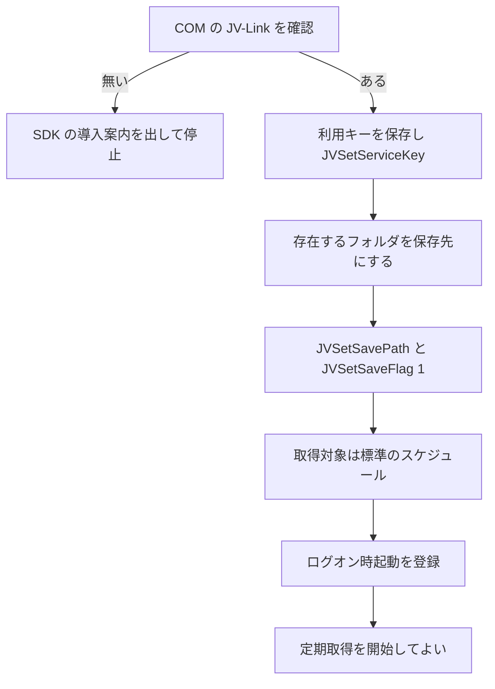
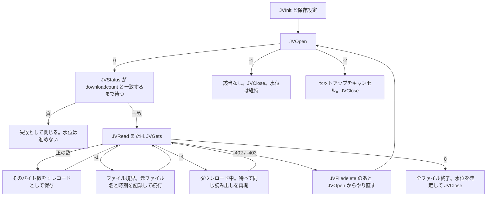
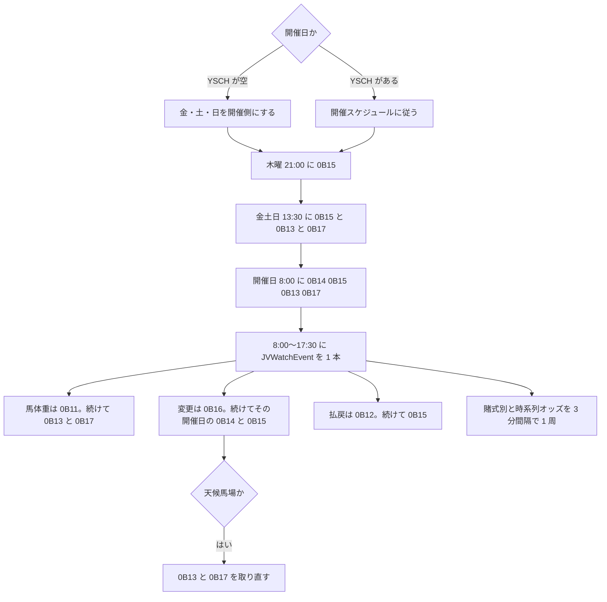

# JV-Data 収集常駐アプリ 設計

- 状態: ドラフト
- 日付: 2026-11-03
- 全体の要求: [../requirements.md](../requirements.md)
- 全体の構造: [../architecture.md](../architecture.md)
- 要求: [requirements.md](requirements.md)
- 構造: [architecture.md](architecture.md)
- デプロイ: [deployment.md](deployment.md)
- マニュアル: [manual.md](manual.md)
- ローダ: [../dwh-loader/requirements.md](../dwh-loader/requirements.md)
- 正とする公式版:
  - [JV-Data 仕様書 Ver.4.9.0.1](https://jra-van.jp/dlb/sdv/sdk/JV-Data4901.pdf)（2024-08-07）
  - [JV-Link インターフェース仕様書 Ver.4.9.0.1](https://jra-van.jp/dlb/sdv/sdk/JV-Link4901.pdf)（2024-08-07）
  - [開発ガイド 第4.2.3版](https://jra-van.jp/dlb/sdv/sdk/DataLab423.pdf)（2026-07-31）
  - SDK 本体は [32bit Ver.5.0.0](https://jra-van.jp/dlb/sdv/sdk.html)（2026-08-04）

この文書は、要求を満たすための取得手順、対象データ、保存形式、受入条件を定義する。プロセス分割とスレッドは [architecture.md](architecture.md)。レコードのバイト定義は公式仕様書を正とし、ここでは再定義しない。

## 1. 前提と制約

- 開発ガイド 2.1 の JV-Link 動作環境は、日本語版 Windows 11、インターネット接続。
- JV-Link は利用者がインストールし、利用規約に同意済みである。同意前の `JVOpen` は `-305` になる。
- 公式に配布される JV-Link は 32bit である。アプリのプロセスは x86 とし、32bit の COM サーバだけを使う。設定画面は同時に開けない。
- JV-Link の設定はユーザのレジストリにあり、設定ダイアログは対話デスクトップを必要とする。収集はログオン中のセッションで行う。Session 0 の Windows サービスからは呼ばない。
- COM 呼び出しは専用の STA スレッド 1 本に直列化する。`JVOpen` から `JVClose` までを重ねない（重ねると `-202`）。
- 時刻は日本標準時。`fromtime` は `YYYYMMDDhhmmss`。
- ソフトウェア ID（`JVInit` の `sid`）は 64 バイト以内、先頭はスペース以外。
- 利用キー登録後の変更は、JV-Link の再インストールが必要（`JVSetServiceKey` の `-101`）。アプリは上書き更新を試みない。
- 保存パスそのものが存在しないと `JVOpen` / `JVRTOpen` は `-211` になる。実ファイルは指定パス配下の `cache` と `data` に作られる。

## 2. 実装の枠

実装は C#、Windows Forms、x86 のトレイアプリとする。ターゲットフレームワークは `net10.0-windows`（.NET 8 以降。採用するのは現行 LTS の .NET 10。サポート期限 2028-11-14）。.NET 8 と .NET 9 は 2026-11-10 にサポートが終わるため、新規の TFM にはしない。モジュール分割、スレッド、配置は [architecture.md](architecture.md)。

設定は `%AppData%` 配下の JSON。利用キーは DPAPI で暗号化し、画面とログに出さない。構造体は後続ローダが使い、収集アプリはバイト列を分解しない。

2026-10-24 決定。

- 言語は C#。UI は Windows Forms。プロセスは x86。
- ターゲットフレームワークは `net10.0-windows`。.NET 8 以降のうち、現行 LTS の .NET 10 を使う。
- ログオン起動のトレイ常駐。ビット数は公式の 32bit JV-Link に合わせる。
- 倉庫データベースは PostgreSQL。書くのは倉庫ローダだけで、収集アプリは接続しない。導入は [../dwh-loader/postgresql.md](../dwh-loader/postgresql.md)。
- 収集アプリの正本はローカル raw と SQLite。倉庫の PostgreSQL へは直接書かない。
- 初回の全期間取得は利用者の開始操作だけ。定期実行は option = 1。
- 速報は、出走馬名表からのレース情報、馬体重、開催情報、速報マイニングを発表に合わせて取る。オッズは 3 分間隔の 1 周。変更系は `JVWatchEvent`。
- 項目解釈と倉庫ロードは別プロセス。

## 3. 初回設定

次が終わるまで定期取得を始めない。

1. COM の JV-Link が登録されているか確認する。無ければ SDK の導入案内を出して停止する。
2. 利用キーを保存し、`JVSetServiceKey` する。既登録（`-101`）は成功とみなす。
3. 存在するフォルダを保存先にし、`JVSetSavePath` と `JVSetSaveFlag(1)` を設定する。空き容量の目安を表示する。全期間セットアップは大きい。
4. 取得対象の初期値は [5. 取得対象](#5-取得対象) の定期差分と、[5.4](#54-提供タイミングに合わせた実行) のスケジュールである。変更は「蓄積データ」と「開催日の速報」の画面で行い、各値のとなりに初期値を残す。
5. ログオン時起動を登録する。

`JVSetUIProperties` はメニューから開ける。キャンセル（戻り値 0）と失敗（`-100`）を区別する。

## 4. 蓄積データの取得

dataspec は 4 文字固定で、1 回の `JVOpen` に 1 つだけ渡す。複数連結は仕様上可能だが、対象ファイルが多いと `JVRead` が遅くなる既知の障害がある。

水位は dataspec ごと、かつ option ごとに持つ。次回の `fromtime` には、前回 `JVOpen` が返した `lastfiletimestamp` を使う。`fromtime` の比較は「指定時刻より大きい」。終了時刻をハイフンで続ける指定は、次の dataspec では使わない。使うと `JVOpen` が `-1`（該当データなし）になる。

- `TOKU`
- `DIFF` / `DIFN`
- `HOSE` / `HOSN`
- `HOYU`
- `COMM`

処理手順:

1. `JVInit`
2. `JVSetServiceKey` / `JVSetSavePath` / `JVSetSaveFlag`
3. `JVOpen(dataspec, fromtime, option, readcount, downloadcount, lastfiletimestamp)`
4. `JVStatus` が `downloadcount` と一致するまで待つ。負の値なら失敗として閉じる。
5. `JVRead` または `JVGets` を、戻り値 0 まで繰り返す。
6. ファイル全体を読み終えたときだけ水位を `lastfiletimestamp` に進める。
7. `JVClose`

`option` はインターフェース仕様書の定義に従う。

| option | 意味 | このアプリでの使い方 |
| --- | --- | --- |
| 1 | 通常データ。`fromtime` より新しい全期間 | 定期差分 |
| 2 | 今週データ。約 1 週間分 | 使わない。非蓄積系向け |
| 3 | セットアップ。呼び出しのたびに取得元ダイアログ | 手動の再セットアップ |
| 4 | セットアップ。ダイアログは初回のみ | 初回の全期間取得 |

スタートキット（CD/DVD）の提供は 2022 年 3 月で終わっている。セットアップダイアログではサーバー取得を選ぶ。

読み出しの戻り値:

| 戻り値 | メソッド | 動作 |
| --- | --- | --- |
| 0 | `JVOpen` | オープン成功。ダウンロード完了を待ってから読む |
| -1 | `JVOpen` | 該当データなし。エラーではない。`JVClose` して水位は維持する |
| -2 | `JVOpen` | セットアップをキャンセルした。`JVClose` |
| 正の数 | `JVRead` / `JVGets` | そのバイト数を 1 レコードとして保存する |
| 0 | `JVRead` / `JVGets` | 全ファイル終了。水位を確定する |
| -1 | `JVRead` / `JVGets` | ファイル境界。元ファイル名と `m_CurrentFileTimestamp` を記録して続行する。全ファイルの終わりでは -1 の次に 0 が返る |
| -3 | `JVRead` / `JVGets` | ダウンロード中。待って同じ読み出しを再開する |
| -402 / -403 | `JVRead` / `JVGets` | ファイル異常。`JVFiledelete` で該当ファイルを消し、`JVOpen` からやり直す |

中断と再開:

- 通常データ: 最後に読んだファイルの `m_CurrentFileTimestamp` を次回 `fromtime` にする。
- セットアップ: 最後に読んだファイル名を保持し、同じパラメータで `JVOpen` したあと、そのファイルまで `JVSkip` する。
- 終了時は `JVCancel` のあと `JVClose` する。読み途中の水位は確定しない。

再試行しないコード: `-111` `-112` `-113` `-114` `-115` `-116` `-201` `-211` `-301` `-302` `-303` `-305`。設定または契約の問題として要対応にする。

バックオフするコード: `-411` `-412` `-413` `-421` `-431` `-502` `-503` `-504`。`-504` はサーバーメンテナンス。`-412` は公式にも障害以外の原因があり得るとされている。案内が無い `-412` は環境要因として扱い、無限リトライにしない。

## 5. 取得対象

dataspec に含まれるレコードは増える。未知のレコード種別 ID も raw には残す。捨てるのは後続ローダの解釈段だけとする。公式の注意どおり、不明 ID を読んでも処理が止まらないこと。

`DIFN` `BLDN` `SNPN` `HOSN` は 2023-08-08 以降の提供分で、繁殖登録番号・生産者コード・生産者名の桁拡張後のレイアウトである。履歴は拡張前の `DIFF` `BLOD` `SNAP` `HOSE` にあり、現行差分は N 付きにも出る。両方を保存する。

地方競馬と海外国際レースの `RA` / `SE` は `RACE` ではなく `DIFF` / `DIFN` に入る。範囲はデータ種別一覧の注記のとおり（中央交流、中央出走馬の地方過去走、中央所属馬が出走した海外国際レース）。

### 5.1 定期差分（option = 1）

インターフェース仕様書 4.9.0.1 で option = 1 に指定できるもの。

| dataspec | 名称 | 主なレコード種別 ID |
| --- | --- | --- |
| `TOKU` | 特別登録馬 | `TK` |
| `RACE` | レース情報（中央の番組・成績・確定オッズ・票数・払戻・WIN5・競走馬除外） | `RA` `SE` `HR` `H1` `H6` `O1` `O2` `O3` `O4` `O5` `O6` `WF` `JG` |
| `DIFF` | 蓄積情報（拡張前レイアウト、地方・海外の `RA`/`SE` を含む） | `UM` `KS` `CH` `BR` `BN` `RC` `RA` `SE` |
| `DIFN` | 蓄積情報（2023-08-08 以降の拡張レイアウト） | 同上 |
| `BLOD` | 血統情報 | `HN` `SK` `BT` |
| `BLDN` | 血統情報（拡張レイアウト） | 同上 |
| `SNAP` | 出走時点の着度数 | `CK` |
| `SNPN` | 出走時点（拡張レイアウト） | `CK` |
| `SLOP` | 坂路調教 | `HC` |
| `WOOD` | ウッドチップ調教 | `WC` |
| `YSCH` | 開催スケジュール | `YS` |
| `HOSE` | 競走馬市場取引価格 | `HS` |
| `HOSN` | 市場取引価格（拡張レイアウト） | `HS` |
| `HOYU` | 馬名の意味由来 | `HY` |

`COMM`（`CS`）と `MING`（`DM` `TM`）は、JV-Data 仕様書の組合せ表では option = 1 に含まれるが、インターフェース仕様書の組合せ表には無い。実装は `JVOpen` を呼び、`-116` のときは定期対象から外して option = 4 のセットアップに残す。どちらが通るかは Data Lab. 検証ツールで確定する。

### 5.2 初回セットアップ（option = 4、利用者の開始操作のみ）

option = 1 の一覧に加え、インターフェース仕様書が option = 3, 4 で許可する `COMM` と `MING`。

`TOKU` のセットアップは当週と翌週だけで、過去分は option = 1 で `fromtime` を過去にして取る。

### 5.3 取らないもの

| dataspec | 理由 |
| --- | --- |
| `TCOV` `TCVN` `RCOV` `RCVN` | 非蓄積系ソフト向けの、マスタと過去走の補てん。蓄積系の本アプリでは `DIFF` / `BLOD` / `RACE` が正本 |
| option = 2 の今週データ | 約 1 週間の切り出し。水位管理と重複する |
| `0B30` | 全賭式オッズ。`0B31`〜`0B36` と内容が重なる。初期実装は賭式別を取る |

### 5.4 提供タイミングに合わせた実行

データ提供タイミング（JV-Data 仕様書 第6章）の直後に差分が走るよう、次を初期スケジュールにする。時刻は日本標準時。利用者は蓄積と速報を別画面で変えられる。画面の既定列には、この表の初期値を残す。未保存の設定は、この初期値のまま動く。

| 時刻 | 対象 |
| --- | --- |
| 毎日 06:30 | `SLOP` `WOOD`。調教は毎日・不規則で、月曜は基本的に無い |
| 毎日 13:30 | option = 1 の全対象。金曜・土曜 12:00 頃の `RACE` を拾う |
| 月曜 15:00 | `DIFF` `DIFN` `BLOD` `BLDN` `SNAP` `SNPN` `YSCH` `MING`（通る場合）`RACE`。月曜 14:00 頃の更新のあと |
| 木曜 21:00 | `RACE` `DIFF` `DIFN` `BLOD` `BLDN` `SNAP` `SNPN`。木曜 20:00 頃の出馬表・着度数のあと |
| 日曜 21:00 と月曜 21:00 | `TOKU`。ハンデ発表前後の夕刻更新のあと |
| 火曜 12:00 | `HOYU` |
| 毎日 23:00 | option = 1 の全対象。不定期の訂正を拾う |

スリープで時刻を逃した場合は、復帰後にその日の遅れたジョブを 1 回ずつ実行する。

毎週月曜 06:30 に、各 dataspec の `fromtime` を 7 日前まで戻して再読込する。再読込で水位は後退させない。同一バイトは raw のハッシュで吸収する。

速報の `0B15` `0B13` `0B17` は、上の時刻の枠に `JVRTOpen` のジョブを足す。木曜 21:00 の `0B15` は、取得済み `YSCH` のこれから来る開催日を取る。`YSCH` が空なら次の金・土・日を取る。木曜そのものは開催日でなくてよい。金・土・日で開催側の 13:30 は `0B15` `0B13` `0B17`。開催日 8:00 は監視を張る前に、その開催日の `0B14` `0B15` `0B13` `0B17` を 1 回ずつ取る。速報は水位を進めない。契機の対応は第 6 章。

## 6. 速報

開催日は取得済み `YSCH` で判定する。`YSCH` が空の間は金・土・日を開催側として扱い、取得後にスケジュールへ切り替える。

速報の提供期間は、時系列オッズ（`0B41` `0B42`）が 1 年、それ以外は 1 週間。確定成績の長期保存は `RACE` が担う。速報は確定前の出馬・馬体重・開催情報・マイニングと、確定オッズには残らない時系列を残すために取る。

必ず取るのは次の 6 つである。発表のタイミングに合わせて `JVRTOpen` する。

| dataspec | 名称 | 主なレコード | いつ取る | キー |
| --- | --- | --- | --- | --- |
| `0B15` | 速報レース情報（出走馬名表〜） | `RA` `SE` `HR` | 木曜 21:00（出走馬名表のあと）。金・土の 13:30（出馬表のあと）。開催日 8:00。変更イベントと払戻イベントのあと | 開催日、または `YYYYMMDDJJRR` |
| `0B11` | 速報馬体重 | `WH` | 馬体重イベント。発走の約 1 時間前 | イベントの key。開催日またはレースでも可 |
| `0B14` | 速報開催情報（一括） | `WE` `AV` `JC` `TC` `CC` | 開催日 8:00 に 1 回。変更イベントのたび | 開催日 `YYYYMMDD` |
| `0B16` | 速報開催情報（指定） | 同上 | 騎手変更、天候馬場、コース変更、出走取消、発走時刻変更のイベント | イベントが返す key |
| `0B13` | 速報タイム型マイニング | `DM` | 金・土・日の 13:30（前日予想）。天候馬場のあと（当日予想）。馬体重のあと（直前予想）。開催日 8:00 | 開催日またはレース |
| `0B17` | 速報対戦型マイニング | `TM` | `0B13` と同じ | 同上 |

`0B13` と `0B17` は対で取る。仕様上、最新予想のたびに上書きされる。

あわせて取るもの:

| dataspec | 名称 | 主なレコード | キー |
| --- | --- | --- | --- |
| `0B12` | 速報レース情報（成績確定後） | `RA` `SE` `HR` | 開催日、または `YYYYMMDDJJRR` |
| `0B31`〜`0B36` | 賭式別の速報オッズ | `O1`〜`O6` | レース `YYYYMMDDJJKKHHRR` または `YYYYMMDDJJRR` |
| `0B20` | 速報票数 | `H1` `H6` | レース |
| `0B41` `0B42` | 時系列オッズ（単複枠、馬連） | `O1` `O2` | レース |
| `0B51` | 速報 WIN5 | `WF` | 重勝式開催 |

`0B14` は公式の取り消し規則に従う。レコードを取得できたときだけ、その開催日の前回スナップショットを無効にし、今回含まれていたレコードだけを有効にする。`JVRTOpen` の `-1`（該当なし）では世代を動かさない。騎手変更などが発表後に取り消されると、次回の `0B14` から該当レコードが消える。raw は追記のまま、台帳側で世代を切り替える。

変更情報が出ると、`0B15` の該当項目は即時に更新される。そのため変更イベントのあと、同じ開催日の `0B15` を取り直す。払戻の各段階（3 着まで、5 着まで、全馬着順、コーナー通過順）でも `0B15` が進むので、払戻イベントのあとも取り直す。

イベント:

- 開催時間帯に `JVWatchEvent` を 1 本だけ開始し、終了時に `JVWatchEventClose` する。初期の監視時間は開催日 8:00〜17:30。
- コールバックでは `JVRTOpen` しない。`bstr` を key にしたジョブをキューへ入れる。
- 馬体重は `0B11`。続けて `0B13` と `0B17` を取る。直前予想は馬体重発表後に出る。
- 騎手変更、天候馬場、コース変更、出走取消、発走時刻変更は `0B16`。続けてその開催日の `0B14` と `0B15` を取る。天候馬場のときだけ `0B13` と `0B17` も取る。当日予想は天候馬場発表後に出る。
- 払戻は `0B12`。続けて同じキーで `0B15` を取る。
- オッズはイベントが無い。金曜発売がある場合は金曜 19:00 以降、それ以外は開催日の発走帯に、レースごとに `0B31`〜`0B36` と `0B41` `0B42` を 3 分間隔で 1 周する。周回は 1 本に限る。金曜オッズだけ 19:00〜21:00 を足す。
- 同じ dataspec が実行中または待ちのあいだに取り直しが来たら、今の 1 件が終わったあとに 1 回だけ積む。待ちは 1 件まで。

## 7. 操作と表示

メニューは「ホーム」「今すぐ取得」「セットアップ」「蓄積データ」「開催日の速報」「状態」「JV-Link 設定」「ログの場所」「終了」。画面の並びは [requirements.md](requirements.md) のワイヤーフレームを正とする。蓄積の画面は種類ごとの取得、曜日、時刻、読み直しを持ち、速報の画面は種類の取得と、定時・監視・オッズの時刻を持つ。どちらも初期値をとなりの列に出す。

ホームは起動時に開く窓口である。先頭行は要対応のメッセージ、起動準備、取得中の進み具合、または「待機」である。取得中は状態ウィンドウと同じプログレスバーを出す。一覧は種類と次回予定だけで、option、水位、最終結果、件数は「状態」に残す。ボタンはメニューの「今すぐ取得」「セットアップ」「蓄積データ」「開催日の速報」「状態」「JV-Link 設定」「ログの場所」と同じ操作である。「閉じる」は窓を閉じるだけで、常駐も取得も終わらない。通知領域のアイコンをダブルクリックしても開く。

アイコンは待機、取得中、要対応の 3 状態。要対応は利用キー拒否、規約未同意、JV-Link 未設定、保存先に書けない、ディスク残量 5 GB 未満。通信の一時失敗では要対応にしない。

状態ウィンドウは dataspec ごとに、option、水位、最終成功、最終件数、最終エラー、次回予定を出す。取得中はプログレスバーを出す。ダウンロード中は `JVStatus / downloadcount`、読み込み中は `m_CurrentReadFilesize / m_TotalReadFilesize`（KB。取れないときは読了ファイル数 / `readcount`）である。残りは、その種類のその段階が始まってからの進み方で分にする。段階が変わると測り直す。総量が無いときと、進みが無いあいだは「計測中」。1 分未満は「あと 1 分未満」。蓄積の取り込みは、取得を始めた時点で同じ内容の窓を自動で開く。`JVOpen` が返る前も、種類名と「計測中」を出す。閉じても取得は止めない。

利用者が exe を起動し、初期設定が済んでいるときは「ホーム」を開く。ログオン時起動の登録コマンドには `--background` を付け、その起動では「ホーム」を開かない。すでに常駐しているときの起動は、ミューテックスで拒み、常駐側の「ホーム」を前面に出す。

「今すぐ取得」は option = 1 を 1 巡する。実行中の要求は 1 件だけキューに積む。

## 8. ランディング

### 8.1 バイト列

1 レコードは `JVRead` / `JVGets` が返したバイト列そのもの。Shift_JIS / JIS8 の変換、トリム、項目分割をしない。

公式仕様では、レコードの収録順に保証が無い。同一内容の再送と、データ作成年月日が進んだ訂正の両方が来る。収集側は両方をバイト列として残し、どちらを正本にするかはローダが推奨キーとデータ作成年月日で決める。

ファイルは追記専用。1 フレームの並び:

1. マジック 4 バイト `JVRAW`
2. ファイル内通し番号（64bit、リトルエンディアン）
3. ペイロード長（32bit）
4. ペイロード
5. ペイロードの SHA-256

配置は `{DataRoot}/raw/{dataspec}/{yyyy}/{mm}/{dd}/{seq}.bin`。日付は取得日。1 ファイルの上限は 256 MB。

同一 dataspec で SHA-256 が既存なら追記しない。台帳の重複件数だけ増やす。`0B14` の世代切り替えはハッシュ重複とは別に、開催日ごとの世代番号で表す。

### 8.2 台帳

SQLite に次を持つ。

- dataspec と option ごとの水位、最終成功、最終エラー、連続失敗回数
- 実行履歴（開始、終了、読めた件数、新規件数、重複件数、`JVOpen` の `readcount` / `downloadcount` / `lastfiletimestamp`、戻り値）
- raw ファイルのパス、通し番号の範囲、完了フラグ
- レコード索引（dataspec、先頭 2 バイトのレコード種別 ID、SHA-256、raw 位置、JV-Link の元ファイル名、`m_CurrentFileTimestamp`、取得時刻）
- `0B14` の開催日ごとの世代と、その世代に属する索引

起動時に整合性を確認する。未完了ファイルは、末尾の中途フレームを切り捨ててから追記する。

### 8.3 ローダとの契約

ローダの要求は [../dwh-loader/requirements.md](../dwh-loader/requirements.md)。手順は [../dwh-loader/design.md](../dwh-loader/design.md)。アプリ間の境界は [../architecture.md](../architecture.md)。

ローダが読んでよいのは、完了フラグが立った raw だけ。収集側はファイルを完了にしてから索引を確定し、完了済みファイルを書き換えない。

ローダは次を自分の責務とする。

- 推奨キーとデータ作成年月日による最新行の決定
- 2023-08-08 を境にしたフィールド長の違い
- `RACE` の確定成績と、`0B12` / `0B15` の速報の優先順位
- `0B14` の最新世代だけを有効にすること
- 解釈済みの行を PostgreSQL へ書くこと。導入は [../dwh-loader/postgresql.md](../dwh-loader/postgresql.md)

## 9. 非機能

- ログオン後 1 分以内に常駐し、確定済み水位から再開する。
- 一時障害は 1 分、5 分、15 分、60 分で再試行する。同一 dataspec の同時実行は 1 本。6 回失敗した dataspec はその日の定期実行を止め、翌日に戻す。
- 取得処理が UI を止めない。
- ログは 14 日分のローリングファイル。利用キー、`sid` の全桁、レコード本文は出さない。
- ディスク残量 5 GB 未満で新規取得を止める。既存 raw は削除しない。
- 異常終了のあとは、次回起動だけで回収できる。

## 10. 受入条件

要求の [できていると言える条件](requirements.md) を、次の手順で確認する。

1. JV-Link が無い PC では取得を始めず、導入案内を出す。
2. `YSCH` の option = 1 が成功し、raw と水位が残る。再起動後の再取得で、同一バイトの件数は増えない。
3. `JVOpen` の `-1` を失敗にせず、水位を維持して `JVClose` する。
4. 取得中に終了し、再起動すると通常データは `m_CurrentFileTimestamp` から、セットアップは `JVSkip` で再開し、raw の末尾フレームが中途半端に残らない。
5. `RACE` の option = 4 を手動開始でき、`JVStatus` が `downloadcount` に達してから読み、`-3` をまたいで完了する。
6. `DIFF` または `DIFN` に、地方・海外範囲の `RA` / `SE` が保存される（該当データが提供されている期間で確認）。
7. `0B14` を 2 回取ったとき、台帳の有効世代は 2 回目だけになる。
8. 利用キー未設定では定期実行が始まらず、要対応になる。ログにキー文字列が無い。
9. 保存したペイロードの SHA-256 が、元バイト列の再計算と一致する。
10. 開催日に馬体重イベントを受けたとき、`0B11` と、そのあとの `0B13` と `0B17` が raw に残る。
11. 変更イベントのあと、`0B16` と、その開催日の `0B14` の新しい世代と、`0B15` が残る。`JVRTOpen` の `-1` では `0B14` の世代は動かない。

## 11. 公式レファレンス

公開日時点で SDK コーナー（<https://jra-van.jp/dlb/sdv/sdk.html>）から取れる資料。仕様の改訂は [ドキュメント更新履歴](https://developer.jra-van.jp/t/topic/459) を見る。

| 資料 | 版 | URL | 収集アプリでの用途 |
| --- | --- | --- | --- |
| JV-Data 仕様書 PDF | 4.9.0.1（2024-08-07） | <https://jra-van.jp/dlb/sdv/sdk/JV-Data4901.pdf> | レコードフォーマット、コード表、データ種別、提供タイミング |
| JV-Data 仕様書 Excel | 同上 | <https://jra-van.jp/dlb/sdv/sdk/JV-Data4901.xlsx> | フォーマットシートとデータ種別一覧シート。パーサ実装時の作業用 |
| JV-Link インターフェース仕様書 | 4.9.0.1（2024-08-07） | <https://jra-van.jp/dlb/sdv/sdk/JV-Link4901.pdf> | メソッド、`option` と dataspec の組合せ、戻り値 |
| 開発ガイド | 4.2.3（2026-07-31） | <https://jra-van.jp/dlb/sdv/sdk/DataLab423.pdf> | 動作環境、蓄積系の取得手順、`fromtime` の管理、サンプルの流れ |
| SDK 32bit | 5.0.0（2026-08-04） | <https://jra-van.jp/dlb/sdv/sdk/JVDTLABSDK500_32bit.zip> | このアプリが使う JV-Link。構造体、VB2019 / VC2019 サンプル、検証ツール |
| SDK 案内 | 5.0.0 | <https://developer.jra-van.jp/t/topic/45> | 上記ドキュメントへの入口 |
| イベント開発ガイド（VB / C++） | 2026-08-04 版が SDK 案内に記載 | [SDK トピック](https://developer.jra-van.jp/t/topic/45) 内のリンク | `JVWatchEvent` の言語別の購読方法 |

旧版 PDF（`JV-Data490.pdf` は Ver.4.9.0、`JV-Data480.pdf` は Ver.4.8.0）は履歴確認用。実装の正は 4.9.0.1。

JV-Data 仕様書の構成:

1. 変更履歴
2. データフォーマット。全角は Shift_JIS、半角は JIS8。推奨キー、初期値（`0` / 半角スペース / 全角スペース）
3. 特記事項
4. コード表（競馬場、グレード、馬場、異常区分、着差、品種、性別、毛色、馬記号、見習コードなど）
5. データ種別一覧。蓄積系、速報系、セットアップ、`option` と dataspec の関係
6. データ提供タイミングと提供単位

インターフェース仕様書の、収集に使うメソッド:

| メソッド | 用途 |
| --- | --- |
| `JVInit` | 初期化。`sid` |
| `JVSetUIProperties` | 設定ダイアログ |
| `JVSetServiceKey` | 利用キー |
| `JVSetSaveFlag` | 保存フラグ。本アプリは 1 |
| `JVSetSavePath` | 保存パス。実体は配下の `cache` と `data` |
| `JVOpen` | 蓄積系の取得開始 |
| `JVRTOpen` | 速報の取得開始 |
| `JVStatus` | ダウンロード済みファイル数 |
| `JVRead` / `JVGets` | 1 レコード読み出し。ファイル境界は -1、終端は 0、ダウンロード中は -3 |
| `JVSkip` | セットアップ再開時に、読了済みファイルを飛ばす |
| `JVCancel` | ダウンロードスレッドの停止 |
| `JVClose` | 読み出し終了。次の Open の前に必須 |
| `JVFiledelete` | `-402` / `-403` の異常ファイルを削除 |
| `JVWatchEvent` / `JVWatchEventClose` | 払戻、騎手変更、天候馬場、コース、出走取消、発走時刻、馬体重の通知 |

進捗表示用プロパティは `m_TotalReadFilesize`（KB）、`m_CurrentReadFilesize`、`m_CurrentFileTimestamp`。

サンプルの COM 型は開発ガイド記載の `JVDTLabLib.JVLink`。イベント購読は `WithEvents`（VB）または同等の COM 接続ポイントが必要。

仕様書間の不一致（実装で吸収する）:

- option = 1 に `COMM` と `MING` を含めるかは、JV-Data 仕様書では可、インターフェース仕様書では不可。呼び出し結果の `-116` を優先する。
- インターフェース仕様書の option = 4 は「ダイアログ無し」と書きつつ、初回だけダイアログを出す。初回セットアップは対話セッションで実行する。
