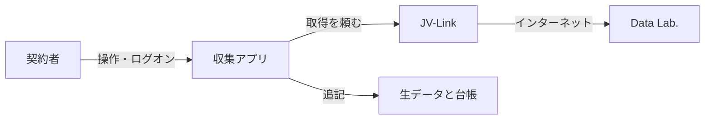
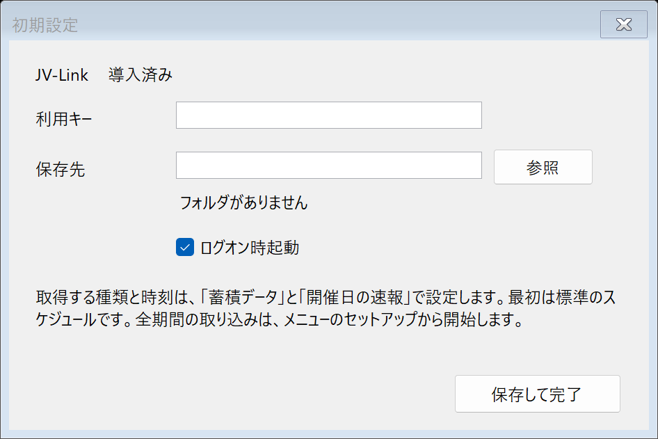
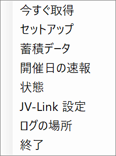
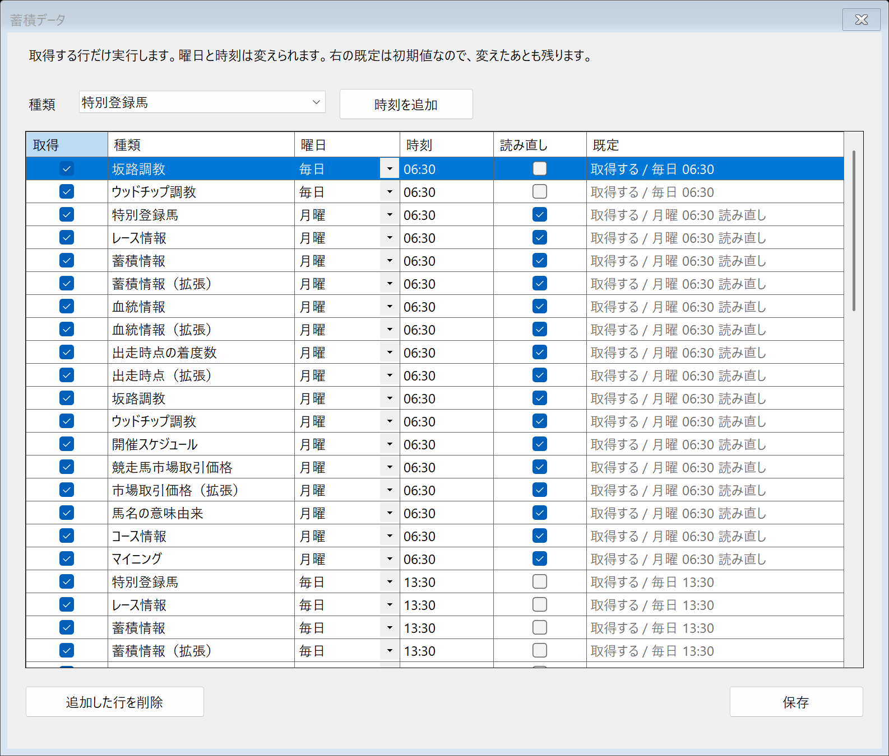
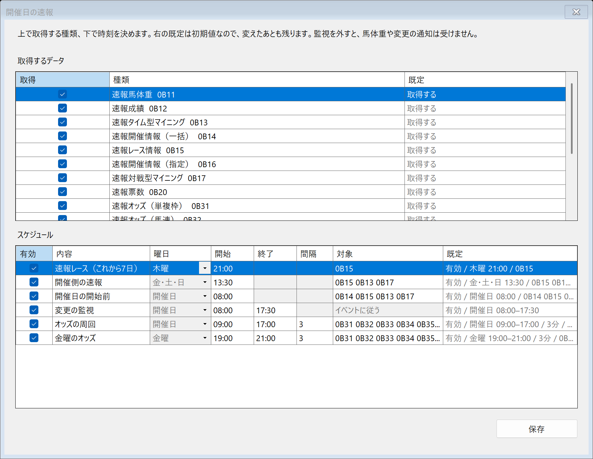
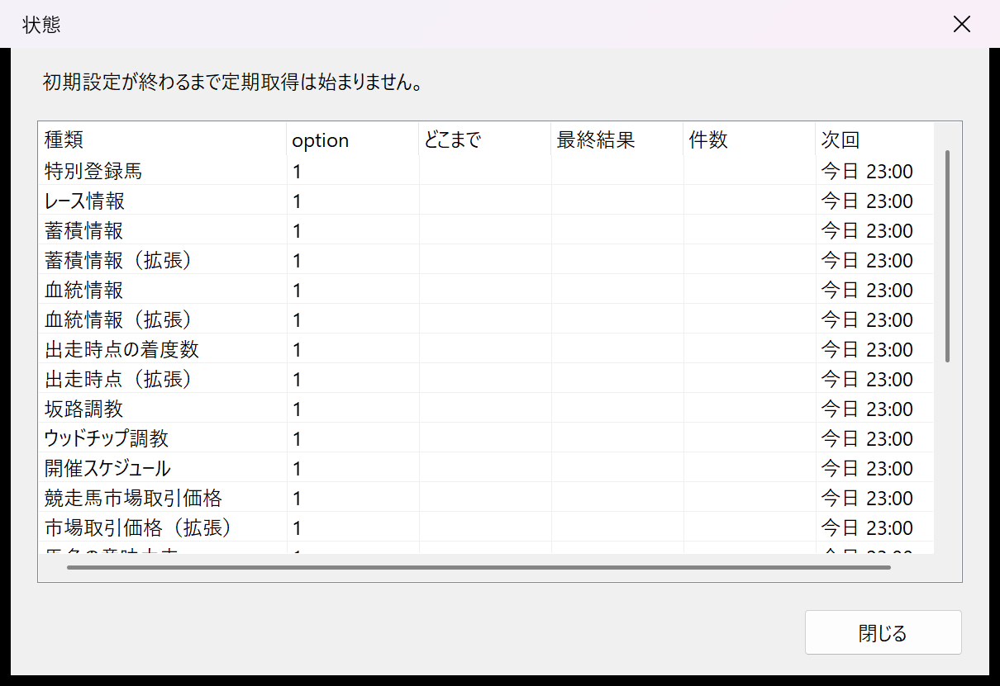

# JV-Data 収集常駐アプリ マニュアル

- 状態: ドラフト
- 日付: 2026-11-03
- 対象: 契約者本人が、この PC で収集アプリを入れて、動かし、止める手順
- 位置づけ: 操作の手順。レコードのバイト定義は [公式の資料](#14-公式の資料) を正とし、ここでは再定義しない。

## 1. このアプリがすること

ログオンしているあいだ、通知領域に常駐し、JV-Link から届くバイト列と、どこまで取ったかの台帳をローカルに残す。

残るのは次である。

- 蓄積データ（番組、成績、マスタ、血統、調教など）の差分
- 開催日の速報。出走馬名表からのレース情報、馬体重、開催情報、タイム型と対戦型のマイニング、オッズ、払戻

PostgreSQL へ書くのは別プロセスのローダである。予想の計算、投票、購入はしない。JV-Link 本体、利用キー、JV-Data は同梱しない。



## 2. 始める前に

| 必要なもの | 内容 |
| --- | --- |
| OS | 日本語版 Windows 11。管理者権限は要らない |
| 契約 | JRA-VAN Data Lab. の利用キー |
| JV-Link | [SDK 5.0.0 の 32bit](https://jra-van.jp/dlb/sdv/sdk.html) を入れ、利用規約に同意する。公式の配布は 32bit である |
| ネットワーク | インターネット。通信そのものは JV-Link が行う |
| 保存先 | あらかじめ作ったフォルダ。全期間の取り込みは容量が大きい。空きが 5 GB を下回ると、新しい取得は止まり、既にあるデータは残る |
| ランタイム | .NET 10 はアプリのフォルダに同梱する。別に入れない |

収集は、ログオンした利用者のセッションで行う。ログオフすると常駐は終わる。PC をスリープさせると、その時刻の取得は復帰後に回る。日付をまたぐと、過ぎた日の枠は実行しない。

## 3. インストール

リポジトリのルートで、公開とインストール先へのコピーを一度に行う。

```powershell
powershell -NoProfile -ExecutionPolicy Bypass -File .\scripts\deploy-collector.ps1
```

インストール先は次の固定パスである。

`%LocalAppData%\Programs\KeibaDwh\Collector\JvDataCollector.exe`

スクリプトは配置のあと exe を起動しない。エクスプローラからこの exe を起動する。初期設定が済んでいるときは「ホーム」が開く。すでに常駐しているときは、新しいプロセスは作らず、常駐側の「ホーム」を前面に出す。ログオン時の自動起動では「ホーム」は開かない。

開発中の `dotnet run` や `bin\Debug` から初期設定を完了しない。ログオン時起動には、そのとき起動していた exe のパスが登録される。更新は [11. 更新](#11-更新)、削除は [12. 終了、移動、削除](#12-終了移動削除)。

## 4. 初期設定

初回起動で、次のどちらかが出る。

- 32bit の JV-Link が無いときは「JV-Link の導入」。SDK を入れてから起動し直す。
- JV-Link があるときは「初期設定」。利用キー、保存先、ログオン時起動が揃うまで、定期取得は始まらない。取得する種類と時刻の初期値は標準のスケジュールで、メニューの「蓄積データ」と「開催日の速報」から変える。

初回の「初期設定」。JV-Link は導入済みで、利用キーと保存先はまだ空である。下の文は、種類と時刻を別の画面で決めると示している。



| 項目 | 操作 |
| --- | --- |
| 利用キー | 初期状態はマスクする。マスクを外すと入力中の文字が見える。保存済みのときは空欄のままでよい。ログには出さない |
| 保存先 | 存在するフォルダを選ぶ。アプリは作らない。空き容量の目安を GB で出す |
| ログオン時起動 | オンのまま保存する。オフでは保存できない |

「保存して完了」が通ると、利用キーを暗号化して保存し、保存先の `jvlink` フォルダを JV-Link の作業場所にし、ログオン時起動を登録し、定期取得を始める。全期間の取り込みはこの画面では始まらない。

保存できないときの表示:

| 表示 | 対処 |
| --- | --- |
| 32bit の JV-Link が入っていません。 | SDK 5.0.0 の 32bit を入れる |
| 保存先のフォルダがありません。 | フォルダを作ってから選ぶ |
| ログオン時起動をオンにしてください。 | チェックを付ける |
| 利用キーを入力してください。 | キーを入れる。保存済みなら空欄でよい |
| 利用キーは登録済みです。変更には JV-Link の再インストールが必要です。 | JV-Link に入っているキーと、入力したキーが一致しない。キーを変えるときは JV-Link を入れ直す |
| JV-Link の設定に失敗しました（コード）。 | コードを控えてログを見る。規約未同意は JV-Link の設定画面で同意する |
| JV-Link を初期化できません。 | アイコンが要対応になる。32bit の JV-Link を入れ直して起動し直す |

完了後、初期設定を開き直すメニューはない。やり直す手順は [13. 設定のやり直し](#13-設定のやり直し)。

## 5. 通知領域

アイコンは円である。色とツールチップで状態が分かる。

| 色 | ツールチップ | 意味 |
| --- | --- | --- |
| 灰 | 待機 | 定期取得ができる状態で、いまは取得していない |
| 青 | 取得中 | 取得の実行中、または実行待ちのジョブがある |
| 赤橙 | 要対応 | 利用者の操作がないと再開できない。通信の一時的な失敗ではこの色にしない |

アイコンを右クリックすると、次のメニューが出る。下の画面は、初期設定の前なのでアイコンは赤橙である。



| メニュー | すること |
| --- | --- |
| ホーム | 起動時の画面を開く。閉じても常駐は終わらない。アイコンのダブルクリックでも開く |
| 今すぐ取得 | 選んである蓄積データを、差分で一周する。実行中に重ねて押しても、待ちは 1 件まで。画面には「待ちました」とは出ない |
| セットアップ | 全期間の取り込みを開始する。確認ダイアログのあと、JV-Link のダイアログが出ることがある。手順は [7. 全期間の取り込み](#7-全期間の取り込み) |
| 蓄積データ | 蓄積の種類、曜日、時刻、読み直しを設定する。既定は右の列に残る |
| 開催日の速報 | 速報の種類と、定時・監視・オッズの時刻を設定する。既定は右の列に残る |
| 状態 | 種類ごとの進捗と次回予定を開く。1 秒ごとに更新する。取得中はプログレスバーで、ダウンロード件数か読み込み量と、その段階の残り時間を出す |
| JV-Link 設定 | JV-Link 自身の設定画面を開く。キャンセルしてもメッセージは出ない。開けないときは「JV-Link の設定画面を開けません。」 |
| ログの場所 | ログのフォルダをエクスプローラで開く |
| 終了 | 実行中の取得を区切って常駐を終える。読み途中の「どこまで取ったか」は確定しない。次の起動で続きから戻る |

初期設定が終わる前に「今すぐ取得」または「セットアップ」を押すと、初期設定が開く。

### 5.1 ホーム

初期設定が済んだあとに exe を起動すると開く。ログオン時の自動起動では開かない。

先頭行は、要対応のメッセージ、起動準備、取得中の進み具合、または「待機」である。取得中はプログレスバーを出す。一覧は種類と次の予定だけで、1 秒ごとに更新する。option、続き位置、最終結果、件数は「状態」で見る。

ボタンは、メニューの「今すぐ取得」「セットアップ」「蓄積データ」「開催日の速報」「状態」「JV-Link 設定」「ログの場所」と同じ操作である。「閉じる」と窓の閉じるボタンは、窓を閉じるだけで常駐は終わらない。常駐を終えるのはメニューの「終了」である。

## 6. いつ何を取るか

時刻は日本標準時。ログオン後、その日の過ぎた時刻のジョブを 1 回ずつ積む。同じ枠を同日に二度は積まない。

メニューの「蓄積データ」と「開催日の速報」で、取得の有無と時刻を変える。表の右端「既定」は初期値で、時刻を変えても残る。標準の行は削除せず、取得のチェックを外す。蓄積では「時刻を追加」で、同じ種類に時刻を足せる。保存すると次の定時から使う。取得をすべて外した蓄積の保存はできない。

`config.json` の `dataspecs` に無い種類は、スケジュールが有効でも取らない。この配列は「蓄積データ」の保存で、取得がオンの種類へ揃う。速報の種類と時刻は `realtimeData` と `realtimeSchedule` に入る。未設定の間は、次の初期値を使う。

### 6.1 蓄積データの画面

メニューの「蓄積データ」。上の説明、種類の選択と「時刻を追加」、一覧、「追加した行を削除」と「保存」の順である。一覧は種類と時刻の組合せで、初期状態では下へ続く。



| 列 | 画面での意味 |
| --- | --- |
| 取得 | オンの行だけ取る。標準の行は消せないので、止めるときはここを外す |
| 種類 | 名前だけ。編集できない |
| 曜日 | 「毎日」、または月曜から日曜 |
| 時刻 | `HH:mm`。`6:30` も保存時に `06:30` へ揃う |
| 読み直し | オンの行は、その曜日と時刻に 7 日前まで読み直す。続き位置は戻さない |
| 既定 | 灰色で編集できない。その行の初期値で、曜日や時刻を変えても残る |

「時刻を追加」は、左の種類に「毎日 12:00」の行を足す。その行の既定は「（追加）」になる。追加した行だけ、「追加した行を削除」で消せる。標準の行で押すと「標準の行は、取得のチェックを外してください。」と出る。取得がすべてオフの保存は「取得対象を 1 つ以上選んでください。」で止まる。曜日が一覧に無いとき、時刻が時刻でないときは、その種類の名前つきで警告して保存しない。

### 6.2 開催日の速報の画面

メニューの「開催日の速報」。上の説明の下に「取得するデータ」、その下に「スケジュール」、右下に「保存」がある。



取得するデータ:

| 列 | 画面での意味 |
| --- | --- |
| 取得 | オンの種類だけ取る。ここを外すと、下の対象に書いてあってもその種類は取らない |
| 種類 | 名前とコード。編集できない |
| 既定 | 灰色。初期値はどれも「取得する」 |

スケジュール:

| 列 | 画面での意味 |
| --- | --- |
| 有効 | オンの枠だけ実行する |
| 内容 | 枠の名前。編集できない |
| 曜日 | 「速報レース（これから7日）」だけ選べる。ほかの行は灰色で固定 |
| 開始 | `HH:mm` |
| 終了 | 変更の監視、オッズの周回、金曜のオッズだけ入れる。ほかは灰色 |
| 間隔 | オッズの 2 行だけ、分で入れる。初期値は `3`。ほかは灰色 |
| 対象 | 種類コードを空白、カンマ、読点で並べる。変更の監視は「イベントに従う」で灰色 |
| 既定 | 灰色。初期の曜日、時刻、間隔、対象。セル幅を超えると右が「...」になる |

既定が見切れていても、初期値の中身は [6.3](#63-蓄積データの定時) と [6.4](#64-開催日) の表に対応する。終了が開始より前、間隔が 1 から 180 の整数でない、対象のコードが速報に無いときは、その枠の名前つきで警告して保存しない。監視の有効を外すと、馬体重や変更の通知は来ない。

### 6.3 蓄積データの定時

差分の起点は、初期設定を保存した時刻である。そこより新しい分から取る。過去に遡るのは、全期間の取り込みと、月曜朝の読み直しだけである。

| 時刻 | 対象 |
| --- | --- |
| 毎日 06:30 | 坂路調教、ウッドチップ調教 |
| 毎日 13:30 | 取得対象に選んだ蓄積の一式 |
| 月曜 15:00 | 蓄積情報、血統、着度数、開催スケジュール、レース情報。マイニングは定時取得が通るときだけ |
| 木曜 21:00 | レース情報、蓄積情報、血統、着度数 |
| 日曜 21:00 と月曜 21:00 | 特別登録馬 |
| 火曜 12:00 | 馬名の意味由来 |
| 毎日 23:00 | 取得対象に選んだ蓄積の一式 |
| 月曜 06:30 | 上の定時に加え、各種類を 7 日前まで読み直す。読み直しで「どこまで取ったか」は戻さない。同じバイトは重ねない |

該当データが無い回は失敗にしない。続き位置も動かさない。状態の最終結果は「該当なし」になる。

コース情報（`COMM`）とマイニング（`MING`）は、定時取得が拒否されたとき（戻り値 `-116`）、定時の対象から外し、全期間の取り込み側に残す。毎回の定時では探さない。

### 6.4 開催日

開催日は、取得済みの開催スケジュールで判定する。スケジュールがまだ無い間は、金曜、土曜、日曜を開催日として扱う。

| 時刻 | 開催日のとき | 内容 |
| --- | --- | --- |
| 木曜 21:00 | その日が開催日でなくてよい | これから 7 日以内に来る開催日の速報レース情報（`0B15`）。スケジュールが空なら、次の金・土・日 |
| 金・土・日 13:30 | その日が開催側 | `0B15` と、タイム型・対戦型マイニング（`0B13` と `0B17`） |
| 開催日 8:00 | スケジュール上の開催日 | 監視を張る前に、その開催日の開催情報一括（`0B14`）、`0B15`、`0B13`、`0B17` を 1 回ずつ |
| 開催日 8:00〜17:30 | 同上 | 変更の監視を 1 本だけ張る |
| 開催日 9:00〜17:00 | 同上 | オッズと票数、WIN5 を 3 分間隔で一周する |
| 金曜 19:00〜21:00 | 翌日か翌々日が開催日。スケジュールが空なら実行する | 土・日の開催に向けたオッズの周回 |

監視で受けたあとに取るもの:

| 通知 | 続けて取るもの |
| --- | --- |
| 馬体重 | 馬体重（`0B11`）のあと、`0B13` と `0B17` |
| 騎手変更、コース変更、出走取消、発走時刻変更 | 開催情報の指定（`0B16`）のあと、その開催日の `0B14` と `0B15` |
| 天候馬場 | 上に加え、`0B13` と `0B17` |
| 払戻 | 成績確定後のレース情報（`0B12`）のあと、`0B15` |

同じ種類の取り直しが実行中に重なったときは、今の 1 件が終わったあとに 1 回だけ積む。

`0B14` は、レコードを取得できたときだけ、その開催日の前回の一式を無効にし、今回の分を有効にする。該当なしでは世代を動かさない。生データは追記のまま残る。

速報の提供期間は、時系列オッズがおよそ 1 年、それ以外はおよそ 1 週間である。確定成績を長く残すのは蓄積のレース情報である。

## 7. 全期間の取り込み

メニューの「セットアップ」だけで開始する。確認は「全期間の取り込みを開始します。容量が大きく、JV-Link のダイアログが出ます。」である。キャンセルすれば始まらない。開始すると、ダウンロード件数が分かる前から画面の右下に進捗の窓が開き、「計測中」と出る。そのあと種類ごとのダウンロードと読み込みをプログレスバーで出す。窓を閉じても取り込みは続く。差分の取得中も、同じ窓が出る。

JV-Link のダイアログではサーバー取得を選ぶ。ダイアログは種類ごとの初回に出る。中断したあとは、同じ操作で続きから読む。

対象は、初期設定で選んだ種類に、コース情報とマイニングを加えたものである。特別登録馬の過去分は差分取得で 1986-01-01 まで遡る。特別登録馬以外は、セットアップ用の取得（ダイアログは初回のみ）で取る。

実行中に「終了」すると、その回の続き位置は確定しない。次の起動で、読み終えたファイルの続きから再開する。

## 8. 残るファイル

```text
%LocalAppData%\Programs\KeibaDwh\Collector\   アプリ本体。更新で中身が入れ替わる
%AppData%\KeibaDwh\Collector\
  config.json          保存先、取得対象、スケジュール、設定完了、差分の起点。利用キーは入らない
  service-key.bin      暗号化した利用キー。同じ PC の同じユーザだけが復号できる
  logs\collector-YYYYMMDD.log
保存先\
  jvlink\              JV-Link の作業ファイル（cache と data）
  raw\                 生データ。日付は取得日
  state\ledger.sqlite  どこまで取ったか、実行履歴、索引
```

ログは 14 日で消える。時刻は UTC。利用キー、ソフトウェア ID の全桁、レコード本文は出さない。

生データのうち、書き込みが完了したファイルは書き換えない。ローダが読んでよいのは完了したファイルだけである。アプリの更新でも、この保存先と `%AppData%` は触らない。

`service-key.bin` を別の PC へコピーしても、利用キーは戻らない。生データと台帳はファイルとしてコピーできる。コピー先では JV-Link の導入と、利用キーの入れ直しが要る。

## 9. 状態の見方

「状態」は、ホームの「状態」か、メニューの「状態」から開く。起動時に自動で開くのは「ホーム」である。

「状態」の先頭行は、要対応のメッセージ、取得中の種類と進み具合と残り時間、または「待機」である。残りは今の段階の進み方から出す。測り始めは「計測中」、1 分未満は「あと 1 分未満」である。下は初期設定の前で、続き位置はまだ空、次回の時刻だけが入っている。



一覧の列:

| 列 | 意味 |
| --- | --- |
| 種類 | 蓄積は「蓄積データ」で取得をオンにしたもの。速報は「開催日の速報」で取得をオンにした馬体重、成績、マイニング、開催情報、レース情報。オッズの周回はこの一覧に出ない |
| option | 蓄積の差分は `1`。速報は「速報」 |
| どこまで | 確定した続き位置。表示は `MM-DD HH:mm`。空は、まだ一度も確定していない |
| 最終結果 | `成功`、`該当なし`、`中止`、`失敗` |
| 件数 | 直近の成功で新しく残した件数。同じバイトの再送は数えない |
| 次回 | `今日 HH:mm`、`明日 HH:mm`、または曜日と時刻。日本標準時 |

失敗のコードは、この一覧には出ない。要対応の文言とログを見る。

## 10. 要対応と失敗

アイコンが赤橙のとき、状態の先頭行に理由が出る。

| 表示 | 対処 |
| --- | --- |
| 32bit の JV-Link がありません。 | SDK 5.0.0 の 32bit を入れ、起動し直す |
| JV-Link を初期化できません。 | 32bit の登録を確認し、起動し直す |
| 初期設定が終わるまで定期取得は始まりません。 | 初期設定を保存する |
| 利用キーがありません。 | [13. 設定のやり直し](#13-設定のやり直し) でキーを入れ直す |
| 利用キーが拒否されました。 | キーを確認する。JV-Link に登録済みのキーを別の値へ変えるには、JV-Link の再インストールが必要 |
| JV-Link の利用規約への同意が必要です。 | メニューの「JV-Link 設定」で同意する |
| 保存先に書けません。フォルダがあるか確認してください。 | 保存先と、その中の `jvlink` フォルダがあるか確認する |
| 保存先がありません。 | `config.json` の保存先を直し、起動し直す |
| 保存先の空き容量が 5 GB 未満です。新しい取得は止めています。 | 空きを 5 GB 以上にする。既存の生データは消えない |
| JV-Link がエラーを返しました（コード）。 | ログの戻り値を見る。設定か契約の問題として、その日の定時は止める |
| JV-Link の初期化に失敗しました。 | 同上 |

通信の一時的な失敗、サーバメンテナンス、ファイルの異常は、要対応にしない。1 分、5 分、15 分、60 分の間隔で同じ種類をやり直す。同じ種類がその日に 6 回失敗すると、その種類の定時はその日のうち止めて、翌日に回す。ファイル異常は、JV-Link 側の該当ファイルを消して同じ取得をやり直す。

取得の途中で電源が切れても、次の起動で末尾の書きかけを切り捨て、続きから再開する。完了済みの生データは残る。

## 11. 更新

実行中の exe は差し替えできない。

1. 通知領域の「終了」で常駐を終える。
2. リポジトリのルートで、インストールと同じコマンドを実行する。

```powershell
powershell -NoProfile -ExecutionPolicy Bypass -File .\scripts\deploy-collector.ps1
```

先にスクリプトを起動したときは、スクリプトが「終了」を待つ。プロセスは止めない。待ちをやめるときは Ctrl+C。

3. 同じ exe を起動する。利用キー、保存先、続き位置はそのままである。

インストール先だけを置き換える。`%AppData%` と保存先は残る。

## 12. 終了、移動、削除

ふだん止めるときは「終了」を使う。ログオフとシャットダウンでも、実行中の取得を区切って終わる。

同じ PC の別フォルダへ保存先を移すときは、次の順にする。

1. 「終了」で止める。
2. 保存先フォルダごと（`jvlink`、`raw`、`state`）を新しい場所へコピーする。
3. `%AppData%\KeibaDwh\Collector\config.json` の `dataRoot` を、新しいフォルダのフルパスに書き換える。
4. 同じ exe を起動する。

別の PC へ移すときは、生データと台帳をコピーし、移った先で JV-Link を入れ、利用キーを入れ直す。`dataRoot` のドライブが違うときは、初期設定で保存先を直す。

削除で消すもの:

- `%LocalAppData%\Programs\KeibaDwh\Collector\`
- `HKCU\Software\Microsoft\Windows\CurrentVersion\Run` の値名 `KeibaDwh.Collector`

残すもの:

- `%AppData%\KeibaDwh\Collector\`
- 保存先フォルダ

生データと台帳は、ローダが読む正本である。消すときは、利用者の明示があるときだけにする。

## 13. 設定のやり直し

初期設定を開き直すメニューはない。次の順で開く。

1. 「終了」で止める。
2. `%AppData%\KeibaDwh\Collector\config.json` の `settingsComplete` を `false` にする。`differentialEpoch` は、続き位置の起点なので消さない。利用キーのファイルも消さない。
3. exe を起動する。初期設定が開く。利用キーは空欄のままで保存できる。変えるときだけ入力する。
4. 保存先を確認し、「保存して完了」を押す。取得する種類と時刻は「蓄積データ」と「開催日の速報」で確認する。

`config.json` の例:

```json
{
  "dataRoot": "D:\\KeibaData",
  "dataspecs": ["TOKU", "RACE", "DIFF", "DIFN", "BLOD", "BLDN", "SNAP", "SNPN", "SLOP", "WOOD", "YSCH", "HOSE", "HOSN", "HOYU", "COMM", "MING"],
  "launchAtLogon": true,
  "settingsComplete": true,
  "differentialEpoch": "20261103143000"
}
```

`dataspecs` は蓄積の種類コードである。稼働中にこの配列だけを直すと、次の定時からその一覧を使う。`storedSchedule`、`realtimeData`、`realtimeSchedule` が無いときは初期値である。あるときは、その内容と `dataspecs` の両方を満たすものだけを取る。保存先を変えるときは、上の移動手順か、初期設定の保存を通す。`jvlink` フォルダが無い保存先では、取得が「保存先に書けません。」になる。

ログオン時起動を外すときは、「終了」のあと、Run の値名 `KeibaDwh.Collector` を削除する。初期設定を保存すると、また登録される。

## 14. 公式の資料

導入、レコードのバイト定義、メソッドと戻り値は、公開されている次の資料を正とする。このマニュアルでは再定義しない。

| 資料 | 版 | 知りたいこと |
| --- | --- | --- |
| [SDK 5.0.0（32bit）](https://jra-van.jp/dlb/sdv/sdk.html) | 2026-08-04 | JV-Link の導入。公式の配布は 32bit である |
| [開発ガイド](https://jra-van.jp/dlb/sdv/sdk/DataLab423.pdf) | 第4.2.3版（2026-07-31） | 動作環境、蓄積の取得の流れ |
| [JV-Data 仕様書](https://jra-van.jp/dlb/sdv/sdk/JV-Data4901.pdf) | 4.9.0.1（2024-08-07） | レコードの並び、コード、データ種別 |
| [JV-Link インターフェース仕様書](https://jra-van.jp/dlb/sdv/sdk/JV-Link4901.pdf) | 4.9.0.1（2024-08-07） | メソッド、戻り値 |

仕様の改訂は [ドキュメント更新履歴](https://developer.jra-van.jp/t/topic/459) を見る。
