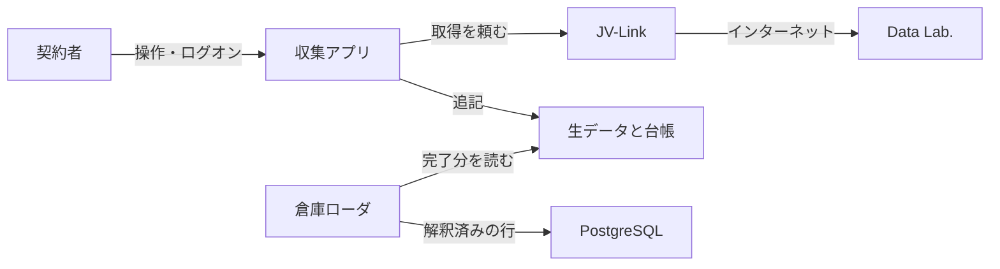
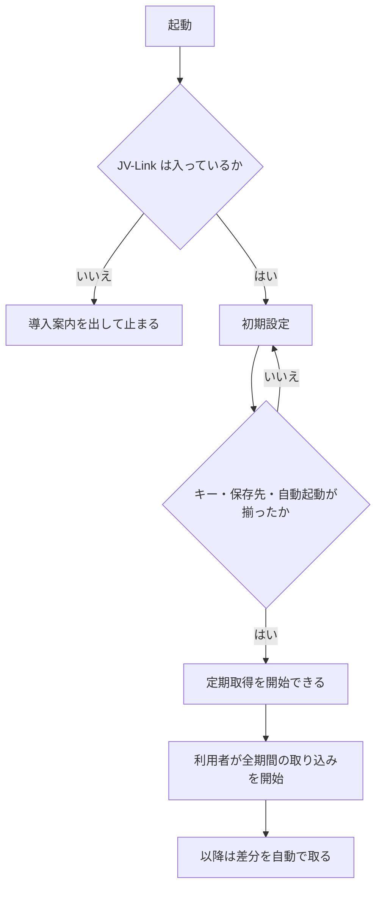
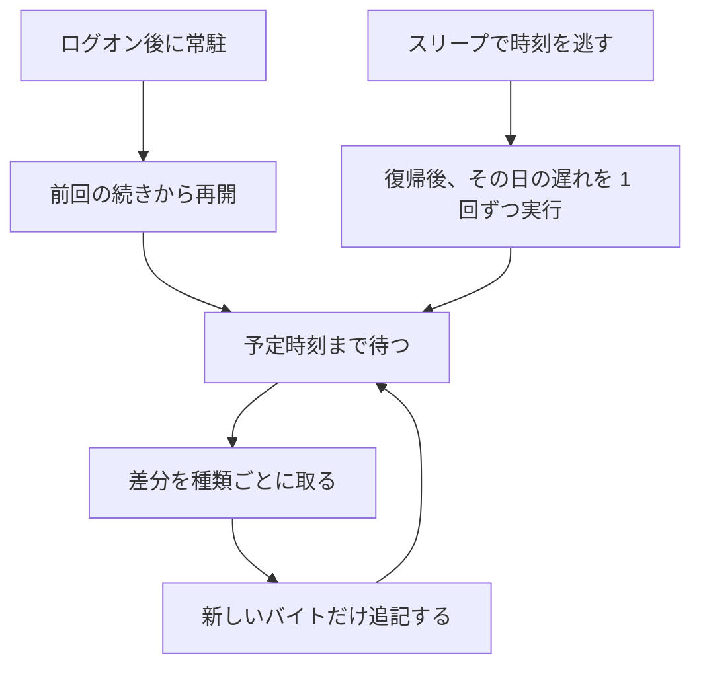
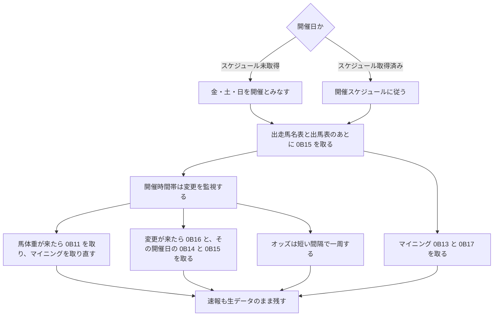

# JV-Data 収集常駐アプリ 要求

- 状態: ドラフト
- 日付: 2026-11-03
- 対象: JRA-VAN Data Lab. の JV-Data を、契約者の PC に欠かさず残す Windows 常駐アプリ
- 全体の要求: [../requirements.md](../requirements.md)
- 全体の構造: [../architecture.md](../architecture.md)
- 手順とデータ形式: [design.md](design.md)
- プロセス構成: [architecture.md](architecture.md)
- デプロイ: [deployment.md](deployment.md)
- マニュアル: [manual.md](manual.md)
- ローダ: [../dwh-loader/requirements.md](../dwh-loader/requirements.md)
- 倉庫: [../dwh-loader/warehouse.md](../dwh-loader/warehouse.md)

レコードのバイト定義は公式仕様書を正とする。この文書では再定義しない。

## 1. このソフトですること

契約者本人の PC で、JV-Link から届く競馬データをそのまま保存し、あとから倉庫へ載せられる状態を保つ。

1. ログオンしているあいだ、通知領域に常駐する。
2. 蓄積データ（番組、成績、マスタ、血統、調教など）を差分で取り続ける。
3. 開催日は、確定前の速報も残す。必ず取るのは、出走馬名表からのレース情報（`0B15`）、馬体重（`0B11`）、開催情報の一括と指定（`0B14` と `0B16`）、タイム型と対戦型のマイニング（`0B13` と `0B17`）である。オッズと払戻も残す。
4. 届いたバイト列と、どこまで取ったかの台帳をローカルに残す。

やらないこと:

- レコードの解釈、集計、予想
- 倉庫（PostgreSQL）への書き込み。書くのは別プロセスのローダ
- JV-Link 本体、利用キー、JV-Data の同梱と再配布
- レース映像、コース画像、勝負服画像
- 公式の注記を超える地方競馬・海外競馬の収集

マスタと過去走は自分で持つ。非蓄積系向けの補てんデータには依存しない。

## 2. データの流れ

収集アプリは Data Lab. と直接通信しない。受け取りは JV-Link に任せ、届いたバイト列を分解せずに残す。項目の意味を決めて PostgreSQL へ書くのは倉庫ローダである。



## 3. 利用者の流れ

### 3.1 最初の一度

JV-Link が入り、利用キー、保存先、ログオン時起動が揃うまで、定期取得は始めない。取得する種類と時刻は標準のスケジュールで始め、蓄積と速報の画面で変える。全期間の取り込みは容量が大きいので、自動では始めず、利用者の開始操作だけで行う。



### 3.2 通常

ログオン後すぐに常駐し、前回の続きから差分を取る。同じ内容の再送は重ねない。PC がスリープで時刻を逃したら、復帰後にその日の遅れを 1 回ずつ実行する。取得の途中で落ちても、次の起動だけで続きから戻る。



週に一度、直近を読み直して取りこぼしを埋める。読み直しで「どこまで取ったか」は戻さない。

### 3.3 開催日

開催日は、取得済みの開催スケジュールで判定する。スケジュールがまだ無い間は、金・土・日を開催側として扱う。

確定成績を長く残すのは蓄積データのレース情報である。速報は、確定前の出馬・馬体重・開催情報・マイニングと、確定後には残らない時系列を残すために取る。



### 3.4 困ったとき

アイコンは 3 状態。待機、取得中、要対応。

要対応になるのは、利用者の手がないと再開できないときだけである。利用キー、規約への同意、JV-Link の導入、保存先、ディスクの残量。通信の一時的な失敗では要対応にせず、間を空けて再試行する。同じ種類がその日に何度も失敗したら、その種類はその日の定期実行を止め、翌日に回す。

## 4. 画面

通知領域のアイコンから操作する。取得処理は画面を止めない。

```text
┌ 収集アプリ ───────────┐
│ ホーム                │
│ 今すぐ取得            │
│ セットアップ          │
│ 蓄積データ            │
│ 開催日の速報          │
│ 状態                  │
│ JV-Link 設定          │
│ ログの場所            │
│ 終了                  │
└───────────────────────┘
```

| メニュー | すること |
| --- | --- |
| ホーム | 起動時の画面を開く。閉じても常駐は終わらない |
| 今すぐ取得 | 通常の差分を一周する。実行中に重ねて押しても、待ちは 1 件まで |
| セットアップ | 全期間の取り込みを、利用者の操作で開始する |
| 蓄積データ | 蓄積の種類とスケジュールを設定する。初期値はとなりに残す |
| 開催日の速報 | 速報の種類とスケジュールを設定する。初期値はとなりに残す |
| 状態 | 種類ごとの進捗と次回予定を開く |
| JV-Link 設定 | JV-Link 自身の設定画面を開く |
| ログの場所 | ログのフォルダを開く |
| 終了 | 取得を区切って常駐を終える。途中の「どこまで取ったか」は確定しない |

初期設定が済んだあとに利用者が exe を起動したときは「ホーム」を開く。ログオン時の自動起動では開かない。すでに常駐しているときは、新しいプロセスは作らず、常駐側の「ホーム」を前面に出す。閉じても常駐は終わらない。アイコンのダブルクリックでも開く。

```text
┌ ホーム ──────────────────────────────────────────────────────┐
│ 待機                                                         │
│ [                                                      ]     │
│                                                              │
│ 種類           次回                                           │
│ レース情報     今日 13:30                                     │
│ 蓄積情報       今日 13:30                                     │
│ 調教           明日 06:30                                     │
│                                                              │
│ [今すぐ取得] [セットアップ] [蓄積データ] [開催日の速報]       │
│ [状態] [JV-Link 設定] [ログの場所]                [閉じる]    │
└──────────────────────────────────────────────────────────────┘
```

先頭行は、要対応のメッセージ、起動準備、取得中の進み具合、または「待機」である。取得中はプログレスバーを出す。一覧は種類と次の予定である。詳しい進捗は「状態」で見る。

初期設定が終わるまで、定期取得は始まらない。

```text
┌ 初期設定 ──────────────────────────┐
│ JV-Link        導入済み / 未導入   │
│ 利用キー       [**************]    │
│ 保存先         [ D:\KeibaData  ]   │
│                空き容量の目安      │
│ ログオン時起動 [x]                 │
│                                    │
│                 [ 保存して完了 ]   │
└────────────────────────────────────┘
```

状態では、種類ごとにどこまで取れたか、最後の結果、次の予定を見る。取得中はプログレスバーで進み具合を出す。同じ行に、今の段階の残りを分で出す。測り始めと総量が無いときは「計測中」、1 分未満は「あと 1 分未満」である。蓄積データの取り込みは、取得を始めた時点で同じ進捗の窓を自動で開く。ダウンロード件数が分かる前も「計測中」を出す。閉じても取り込みは続く。

```text
┌ 状態 ─────────────────────────────────────────────────┐
│ 取得中   レース情報   読み込み   12 / 40 ファイル   30%   あと 8 分 │
│ [=========>                                     ]     │
│                                                       │
│ 種類         どこまで      最終結果    次回           │
│ レース情報   11-01 23:10   成功        今日 13:30     │
│ 蓄積情報     11-01 23:10   成功        今日 13:30     │
│ 調教         11-02 06:31   成功        明日 06:30     │
│ 特別登録馬   10-27 21:02   成功        日曜 21:00     │
│                                                       │
│                                         [ 閉じる ]    │
└───────────────────────────────────────────────────────┘
```

画面項目の意味、エラー時の見せ方、キューの優先順位は [design.md](design.md) に書く。

## 5. 何を残すか

残すもの:

- 特別登録馬
- レース（番組、成績、確定オッズ、票数、払戻）
- 馬・騎手などの蓄積情報（公式の範囲の地方・海外を含む）
- 血統、出走時点の着度数、坂路調教、ウッドチップ調教
- 開催スケジュール、市場取引価格、馬名の由来
- 開催中の速報。次は必ず取る
  - 速報レース情報（出走馬名表〜）`0B15`
  - 速報馬体重 `0B11`
  - 速報開催情報（一括）`0B14` と、速報開催情報（指定）`0B16`
  - 速報タイム型マイニング `0B13` と、速報対戦型マイニング `0B17`
- 上に加え、成績確定後のレース情報、賭式別オッズ、時系列オッズ、票数、WIN5

残さないもの:

- 蓄積系が自分で持つ情報の、補てん用データ
- 直近およそ 1 週間だけを切り出したデータ
- 全賭式をまとめた速報オッズ（賭式別と内容が重なる）
- 映像と画像

レイアウトが拡張されたあとのデータと、拡張前の履歴は、両方残す。未知のレコード種別も捨てない。どれを正本にするかはローダが決める。種類の正式名、取得時刻、保存形式は [design.md](design.md)。

## 6. 守ること

- ログオン後すぐに常駐し、確定済みの続きから再開する。
- 取得で画面を止めない。
- 利用キーは画面とログに出さない。
- ディスクが残り少ないときは新しい取得を止め、既にあるデータは消さない。
- 異常終了のあとは、次の起動だけで回収できる。
- ローダが読んでよいのは、書き込みが完了した生データだけである。完了したファイルは書き換えない。

再試行の間隔、残量の閾値、ファイル形式、台帳の中身は [design.md](design.md)。

## 7. できていると言える条件

1. JV-Link が無い PC では取得を始めず、導入案内を出す。
2. 差分取得が成功し、再起動後に同じバイトを二重に残さない。
3. 該当データが無い回は失敗にせず、続き位置を維持する。
4. 取得中に終了しても、再起動で途中から続き、中途半端な末尾は残らない。
5. 全期間の取り込みを手動で開始でき、最後まで読める。
6. 速報の開催情報を取り直したとき、有効なのは最新の一式だけになる。
7. 利用キーが無いと定期取得は始まらず、要対応になる。ログにキーは出ない。
8. 保存したバイト列は、受け取った列と一致する。

確認に使う dataspec、戻り値、ハッシュの手順は [design.md](design.md) の受入条件を正とする。
