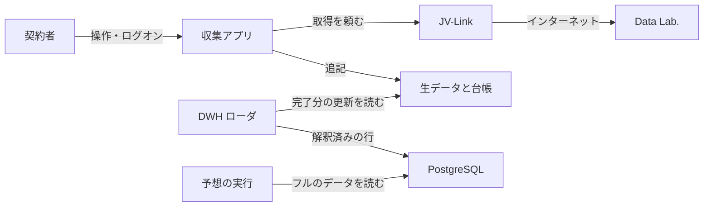

# 競馬データ倉庫 要求

- 状態: ドラフト
- 日付: 2026-11-03
- 対象: 契約者の PC に JV-Data を残し、完了した生データの更新を PostgreSQL へ自動で載せ、開催日の速報が揃ったときに馬券予想モデルをフルデータで自動実行する一式
- 構造: [architecture.md](architecture.md)
- 収集アプリ: [jv-data-collector/requirements.md](jv-data-collector/requirements.md)
- ローダ: [dwh-loader/requirements.md](dwh-loader/requirements.md)
- PostgreSQL: [dwh-loader/postgresql.md](dwh-loader/postgresql.md)

レコードのバイト定義は公式仕様書を正とする。この文書では再定義しない。予想モデルの式、特徴量、学習手順、結果の保存先は、ここでは定めない。

## 1. ゴール

この一式のゴールは、開催日の馬体重などの速報が PostgreSQL に載り終えたとき、そのレースに必要な倉庫のフルのデータを入力にして、馬券予想モデルを自動で実行できることである。

その前提は、ローダのプロセスが動いているあいだに、書き込みが完了した生データへ更新があったとき、そのファイルのために利用者が起動しなくても、解釈済みの行が PostgreSQL に入ることである。ログオン時の自動起動はしない。

## 2. この一式ですること

契約者本人の PC で、JRA-VAN Data Lab. の JV-Data を欠かさず残し、解釈済みの行にして、速報が揃ったレースの予想を自動で始める。仕事は三つに分ける。

1. 収集アプリは、JV-Link から届くバイト列と、どこまで取ったかの台帳をローカルに残す。
2. ローダは、書き込みが完了した生データだけを読み、更新があるたびに解釈した行を PostgreSQL に書く。
3. 予想の実行は、開始契機の速報が倉庫に載り終え、対象レースのフルのデータが揃ったあと、その行を読んで馬券予想モデルを起動する。

フルのデータは、対象レースについて、その時点の PostgreSQL からまとめて読む次の行である。

- 出走馬のマスタと過去走
- 当該レースの番組と、既に確定している成績
- 当該開催の速報。開始の契機になった馬体重、変更、出馬、開催情報に加え、その時点で倉庫にある速報マイニングと最新のオッズを含む

やらないこと:

- 投票、購入、収支の計算
- 収集アプリから PostgreSQL への書き込み
- ローダのプロセスの中での予想計算
- 予想のときに raw や JV-Link を直接読むこと
- JV-Link 本体、利用キー、JV-Data の同梱と再配布
- レース映像、コース画像、勝負服画像
- 公式の注記を超える地方競馬・海外競馬の収集

マスタと過去走は収集アプリが自分で持つ。非蓄積系向けの補てんデータには依存しない。モデルの式が決まるまで、予想専用の子文書は置かない。

## 3. アプリの分担

| 役割 | すること | 文書 |
| --- | --- | --- |
| JV-Data 収集アプリ | ログオン中に常駐し、蓄積の差分と開催日の速報を、分解せずに残す | [jv-data-collector/requirements.md](jv-data-collector/requirements.md) |
| DWH ローダ | 完了した生データの更新を契機に、解釈した行を PostgreSQL へ自動で書く | [dwh-loader/requirements.md](dwh-loader/requirements.md) |
| 予想の実行 | 開始契機の速報が載り終え、フルのデータが揃ったとき、馬券予想モデルを自動で起動する | この文書の 5 |

利用者の操作、画面、取得時刻、保存形式は収集アプリの要求と設計に書く。ローダが行をどう解釈し、完了した生データへどう追随するかは [dwh-loader/design.md](dwh-loader/design.md)。データベース定義は [dwh-loader/schema.md](dwh-loader/schema.md)。予想を起動するプロセスの置き方は [architecture.md](architecture.md) の未決に残す。

## 4. データの流れ

収集アプリは Data Lab. と直接通信しない。受け取りは JV-Link に任せ、届いたバイト列を分解せずに残す。項目の意味を決めて PostgreSQL へ書くのはローダである。予想は、ローダが書き終えた行だけを読む。

## 5. いつ自動で動くか

| 出来事 | PostgreSQL | 馬券予想モデル |
| --- | --- | --- |
| 完了した生データの更新 | 自動で登録する | |
| 馬体重、騎手変更、出走取消、発走変更、天候、馬場、コース変更、出馬、開催情報 | 自動で登録する | 載り終え、対象レースのフルのデータが揃っていれば自動実行する |
| オッズの周回、払戻、速報マイニング、`0B15` の成績確定後の版、蓄積の差分、全期間の取り込み | 自動で登録する | この出来事だけでは開始しない |

フルのデータが揃っているとは、対象レースのマスタ、過去走、番組と、開始契機になった速報を、同じ PostgreSQL から読めることである。初回取り込みの途中で過去走がまだ無いレースは、馬体重が届いても実行しない。

予想を開始する速報が載った時点で、倉庫に既にある最新のオッズと速報マイニングもフルのデータの一部として読む。同じ推奨キーの同じ版を書き直しただけでは、予想を再実行しない。開始契機の新しい版が載ったときは、フルのデータで実行し直す。

`0B15` のうち予想を開始するのは、出走馬名表と出馬表の版である。同じ `0B15` の成績確定後の版は、払戻と同様、この出来事だけでは開始しない。速報マイニング（`0B13` `0B17`）が載っただけでも開始しない。

ローダが当該の行を書き終える前には、予想を開始しない。登録に失敗した更新では開始しない。

## 6. 守ること

- 生バイトの正本はローカルの raw である。PostgreSQL は解釈後の行を持つ。
- ローダが読んでよいのは、書き込みが完了した生データと、それを指す索引だけである。
- 完了した raw は収集アプリが書き換えない。
- 未知のレコード種別は収集側で捨てない。採否はローダが決める。
- 利用キーは収集アプリだけが持ち、画面とログに出さない。
- 収集アプリと PostgreSQL は、同じ契約者の PC に置く。ローダは収集アプリのプロセスに入らない。予想の実行も、収集アプリとローダのプロセスには入らない。
- ローダは、プロセスが動いているあいだ、完了した生データの更新に追随する。利用者はファイルごと、速報ごとにローダを起動しない。ログオン時の登録はしない。
- 予想の入力は、実行時点の PostgreSQL にある対象レースのフルのデータである。

再試行、残量、フレーム形式、台帳の中身は [jv-data-collector/design.md](jv-data-collector/design.md)。PostgreSQL の導入は [dwh-loader/postgresql.md](dwh-loader/postgresql.md)。

## 7. できていると言える条件

1. 保存したバイト列は、収集アプリが受け取った列と一致する。
2. ローダは、完了していない raw を読まない。
3. PostgreSQL に入るのは解釈済みの行だけであり、収集アプリは PostgreSQL に接続しない。
4. 推奨キー、データ作成年月日、速報と確定成績の優先、`0B14` の最新世代は、ローダが決める。
5. ローダのプロセスが動いているあいだに完了した生データが増えたあと、そのファイルのために利用者がローダを起動しなくても、そのファイルから作る行が PostgreSQL に入る。
6. 開催日に馬体重などの開始契機の速報が倉庫へ載り終え、対象レースのフルのデータが揃っているとき、馬券予想モデルが自動で実行される。
7. その実行が読むのは、マスタ、過去走、番組、確定済みの成績、および当該開催の速報を含む、実行時点の倉庫の行である。
8. 過去走がまだ倉庫に無いレースでは、馬体重が登録されても予想を実行しない。
9. オッズの周回、払戻、速報マイニング、`0B15` の成績確定後の版、蓄積の差分だけでは予想を開始しない。これらは PostgreSQL には載る。
10. 投票、購入、収支の計算は行わない。

収集の手順は [jv-data-collector/requirements.md](jv-data-collector/requirements.md) の受入条件を正とする。ローダの手順は [dwh-loader/requirements.md](dwh-loader/requirements.md) と [dwh-loader/design.md](dwh-loader/design.md)。テーブル単位の確認は、データベース定義書が項目列を書き終わるまで未決とする。モデルの式が未定のあいだ、受入で見るのは実行の契機と入力の範囲である。
